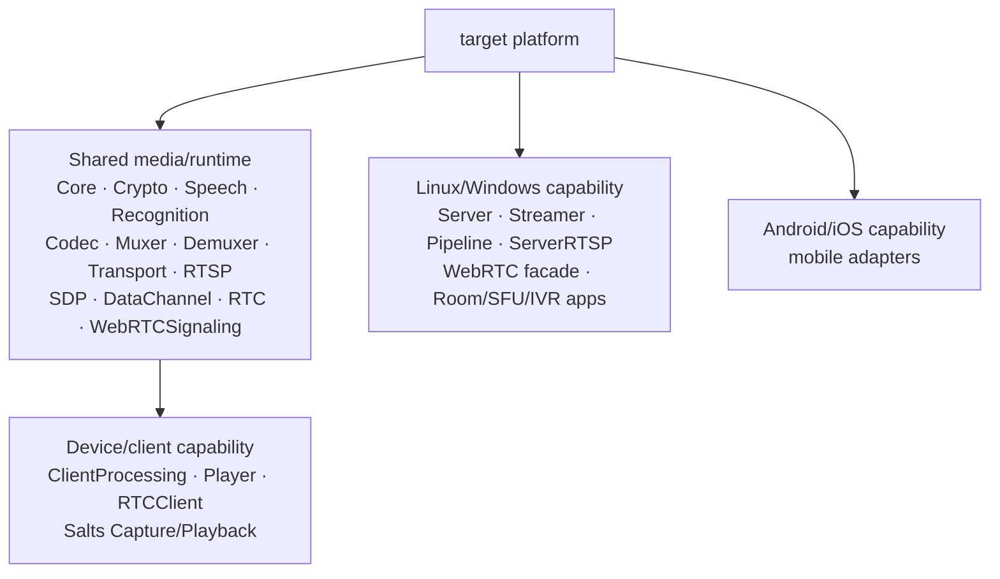
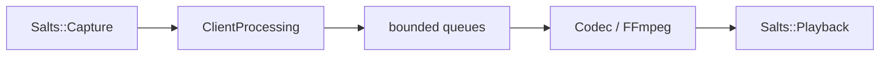
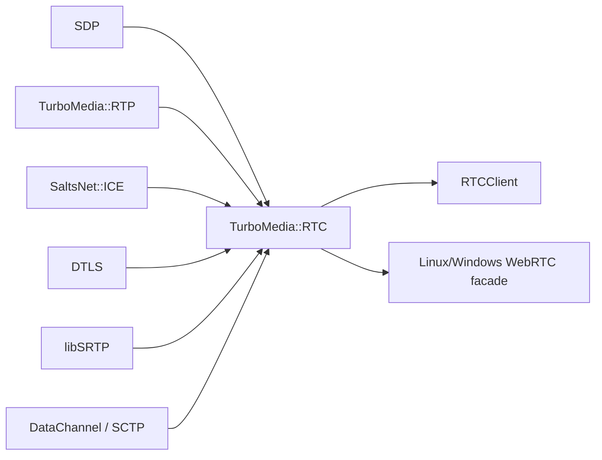
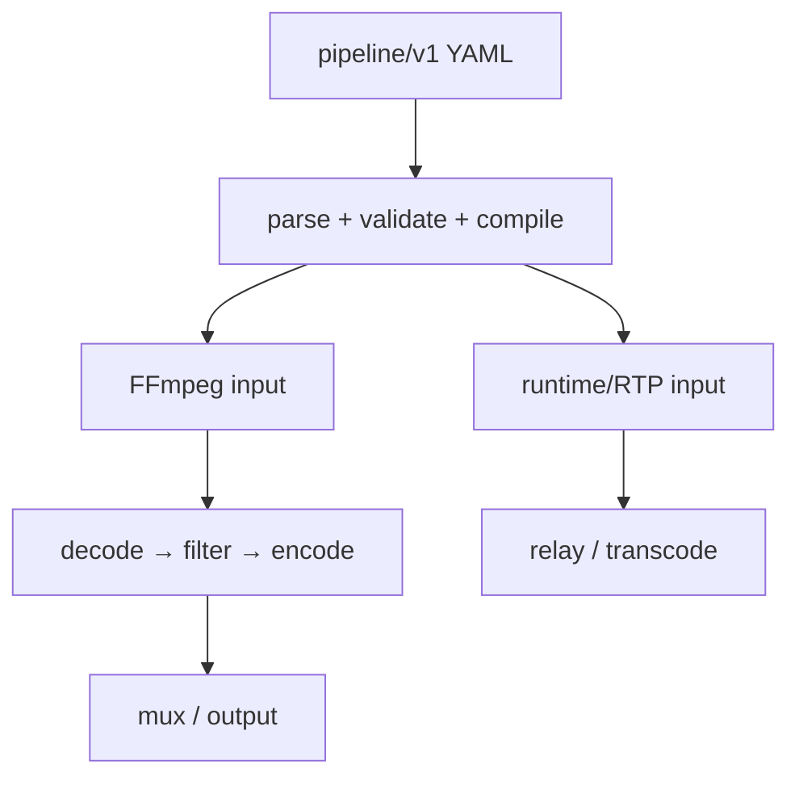
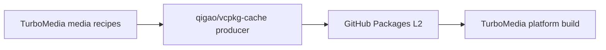
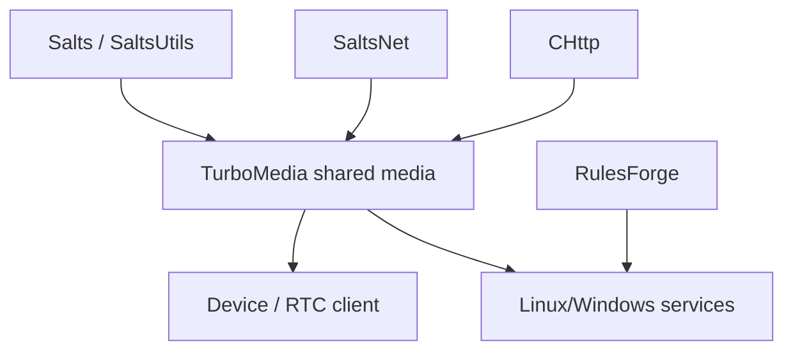

# TurboMedia 2.0 Architecture

TurboMedia 2.0 is a C11/C++17 multimedia runtime with one build graph, explicit
ownership, bounded resources, fail-fast configuration, and platform-selected
capabilities.

When documentation and code disagree, the CMake graph, public headers, and
runtime behavior are the source of truth.

## 1. Architectural rules

1. **One build graph.** Callers do not select a product profile. The target
   platform determines which capabilities exist.
2. **Ownership is explicit.** Network objects, queues, media buffers, runtime
   graphs, and sessions have one owner.
3. **Resources are bounded.** Queues, packet sizes, retained media duration,
   graph nodes, and transport capacities have hard limits.
4. **Unsupported paths fail immediately.** Missing SDKs, cache entries,
   toolchains, codecs, or platform capabilities are errors.
5. **No compatibility fallback.** TurboMedia does not silently switch backend,
   dependency source, transport, or platform behavior.

## 2. Platform capability model

| Platform | Capability set |
| --- | --- |
| Linux | shared media + device I/O + RTC client + desktop services/apps |
| Windows | shared media + device I/O + RTC client + desktop services/apps |
| Android | shared media + device I/O + RTC client + mobile adapter |
| macOS | shared media + device I/O + RTC client |
| iOS | shared media + device I/O + RTC client + mobile adapter |

Desktop services are enabled only when the target system is Linux or Windows.
This is an internal platform capability, not a user-selectable build mode.



## 3. Shared media core

### Source layout

| Directory | Responsibility |
| --- | --- |
| `media/` | Media runtime, codecs, containers, playback, processing, and device adapters |
| `sip/` | SIP signaling and client, SDP, RTP/RTCP, RTP ICE, and voice SDK tests |
| `streaming/` | CNet and HTTP adapters, RTSP, desktop RTSP server adapter, HLS/DASH/RTMP/HTTP-FLV streamers, and YAML pipeline |
| `webrtc/` | RTC and DataChannel libraries, signaling, and RTC applications |
| `streamgraph/` | Typed media graph and provider integration |

Muxer and demuxer share format code in `media/containers/common/`.
`TurboMedia::Transport` provides the CNet, HTTP, and URL adapters.
The layout follows the existing build domains and preserves installed header
paths and platform availability. Source tools and CI path
filters use the new paths. The directory moves and build-path changes can be
reverted together without migrating user data or configuration.

SIP signaling depends on the shared Salts core, containers, crypto and threads.
The SIP client composes it with the shared transport and audio codec targets.
WebRTC and streaming adapters use the media server runtime to publish and
subscribe to sources. Each protocol module owns its wire state and builds its
targets from its own CMake entry point.

### Components

The shared layer is always built.

- `TurboMedia::MediaRuntime` owns the media-source registry, tracks, frame
  publishing, and subscriptions. Its desktop build also owns server runtime
  and protocol session state.
- `TurboMedia::Codec` owns codec-facing conversion.
- `TurboMedia::Muxer` / `TurboMedia::Demuxer` own container boundaries.
- `TurboMedia::Transport` owns the shared network adapters.
- `TurboMedia::SIP` owns SIP signaling. `TurboMedia::RTP` owns media packet I/O.
- `TurboMedia::RTSP` owns protocol parsing/session logic.
- FFmpeg types do not enter the public media ABI.

`media/containers/common/codec_helpers` remains internal to the classic
muxer/demuxer/streamer path. Pipeline keeps native FFmpeg packet/frame timing
inside its own graph.

## 4. Device and local media path

Capture and playback are normal TurboMedia dependencies on every supported
platform.



`TurboMedia::ClientProcessing` owns processing lifecycle and bounded queues.
`TurboMedia::Player` combines container/codec logic with playback.
Platform adapters never replace Salts device ownership.

### SIP voice

The SIP transaction owner advances signaling through `sip_transport_t`. The
media owner binds its own RTP/RTCP endpoints and uses the addresses and payload
types selected by SDP. SIP retransmission and media playout each keep their own
timers and queue budgets. A call handle coordinates dialog events, media start
and stop, and resource drain across the two owners.

`SIP`, `RTP`, `SDP`, and `AudioCodec` can be installed together as static
components. PCM is the device boundary. Apps can supply their own audio I/O or
use `Salts::Media`. SIP code links `TurboMedia::SIP`; media packet code links
`TurboMedia::RTP`.

`sip_registration_poll` drives REGISTER retries and renewal from the signaling
owner, with the existing UAC transaction handling retransmissions and timeout.
Keep the agent and transport context alive until the registration object is
destroyed. It keeps a single Call-ID, increments CSeq, and uses the confirmed
Contact lifetime for scheduling. Digest hashes and nonce generation come from
`Salts::Crypto`. The SIP transaction layer retains the transport callback boundary.
The registration uses SHA-256 when offered and supports legacy MD5 and `qop=auth`.
Digest registration, UTF-8 MESSAGE, and PCMU audio use the loopback registrar and
separate signaling and media UDP ports in tests.

`TurboMedia::SIPClient` composes `SIP`, `SDP`, `RTP` and `AudioCodec` behind
one account handle and one current call. It owns registration and call state,
codec instances, RTP time and the RTCP report schedule. The application owns
signal routing, media endpoints, playout timing and device I/O. The two
transport interfaces can be combined with direct RTP or a separate media owner
with ICE. Callbacks borrow packet and PCM storage until they return.

The client drives transaction deadlines and I/O from one application owner.
The low-level agent can continue to use native timers. An owner-driven agent
admits up to 64 client and 64 server transactions, while the client holds
32 application request slots. Pending or rejected operations surface a status
at admission or a final event. Initial UAC send failure rolls back the
transaction. Client destruction aborts outstanding local transactions and
closes prepared media. Peer-visible BYE and unregister have explicit operations.
Windows packages the client as a DLL with explicit C exports for registration,
call control, voice media, and SIP MESSAGE. The DLL links RTP and the voice
codecs internally. SIP and SDP remain public dependencies because the callbacks
use their types. The install component stages the resolved runtime DLLs.
Other platforms retain the static client and its link dependencies. The platform
split keeps the existing static delivery path and lets Windows applications
deploy one TurboMedia client DLL. The application still owns both transports
and can link the low-level components separately.

Windows applications moving from the static client rebuild against
`TurboMedia::SIPClient` from a fresh SDK prefix and deploy the DLLs from that
prefix together. To roll back, restore the previous SDK and rebuild its
consumers. The transport callback contract and media formats carry over.

The generic SDP answer builder uses offer order, rejects incompatible media
sections by setting port zero, and uses the offered payload mapping. The RTC
PeerConnection already computes its WebRTC-specific answer and calls the
serializer with the negotiated SDP.

`TurboMedia::RTPICE` is an optional transport for an RTP/RTCP-mux media session.
The application owns the media thread and drives the existing SaltsNet ICE agent.
Gathering and connectivity checks are synchronous on that owner. SDP carries the
credentials, candidates and default address; SIP carries the SDP as its body.
Media receive borrows the packet for the callback, and send borrows the packet
until local transport completion. Checked destroy retains the transport when
draining fails. This keeps the ICE agent independent of SIP transactions and
avoids a second networking worker in the adapter. Existing direct UDP callers
continue to link the standalone RTP and SIP components. Media SDP now retains the
connection address, which changes the SDP struct ABI and requires consumer rebuilds.

## 5. RTC and WebRTC

The shared WebRTC subtree provides:

- `TurboMedia::SDP`
- `TurboMedia::DataChannel`
- `TurboMedia::RTC`
- `TurboMedia::RTCClient`
- `TurboMedia::WebRTCSignaling`

RTC owns RTP sessions, RTCP feedback, NACK, TWCC, simulcast, jitter, SRTP, the
media engine, and PeerConnection state. Owner-driven polling advances ICE, DTLS, SRTP,
DataChannel transport, and timers.



The Linux/Windows WebRTC facade additionally integrates desktop
`ServerRuntime`. Android/macOS/iOS do not create that target.

RTC, SIP media, Pipeline, and the recorder use the packet ABI from
`TurboMedia::RTP`. Keeping both serializers would require callers to choose
between incompatible packet layouts with the same symbol. The common packet type
keeps opaque extension bytes and exposes decoded one-byte extensions for RTC.
Parsing borrows the source buffer. After serializing in place, callers parse
again to refresh views before using the packet.

Applications upgrading from the old `Transport` entry points migrate to
`<turbo_rtp_packet.h>` and `rtp_packet_parse` and rebuild against the new
component targets. Roll back by rebuilding and deploying the previous SDK and
its callers together. The wire packet format and stored media require no migration.

## 6. Streaming and desktop services

`streaming/rtsp` owns the RTSP parser and sessions on all supported platforms.
On desktop platforms its server adapter connects RTSP sessions to the source
runtime in `media/runtime`.

RTSP, WebRTC, and Pipeline share runtime handles and call the same media-source
and server APIs. Two shared libraries gave the server runtime a separate binary
dependency on the source registry. A single `TurboMedia::MediaRuntime` library
provides both APIs to these callers and removes one desktop shared library.
The registry and session lifecycles, C headers, and error semantics carry over.
The server API is available on Windows and Linux.

Consumers migrating from `TurboMedia::Core` or `TurboMedia::Server` link
`TurboMedia::MediaRuntime` and rebuild against the new SDK. Use a clean install
prefix to verify the shipped set. To roll back, rebuild and deploy the previous
SDK and its callers together. Existing media and configuration remain valid.

Linux and Windows additionally build:

- `TurboMedia::Streamer`
- `TurboMedia::Pipeline`
- `TurboMedia::ServerRTSP`
- `TurboMedia::WebRTC`
- RoomService / SFU / IVR / signaling applications

RulesForge is required only for this desktop capability.

### Streamer

`TurboMedia::Streamer` provides HLS, DASH, RTMP, and HTTP-FLV on top of the
shared codec/container/transport graph.

### Pipeline

`TurboMedia::Pipeline` executes bounded YAML graphs.



Pipeline does not become a hidden generic state machine. Orchestration/state
semantics remain separate from media graph execution.

## 7. Mobile adapters

`media/mobile` selects adapters only from target platform:

- Android → `media/mobile/android`
- iOS → `media/mobile/ios`

There is no mobile-only compatibility build. The normal platform build must
configure, compile, and install the same TurboMedia graph.

## 8. Build, install, and package export

Every public component is exported through `TurboMediaTargets.cmake` under
the `TurboMedia::` namespace.

```cmake
find_package(TurboMedia CONFIG REQUIRED COMPONENTS RTC DataChannel)
```

The installed package does not record or require a product identity. Requested
components are checked against targets that exist for the current platform.

FFmpeg lookup remains conditional on FFmpeg-backed components such as Muxer,
Demuxer, Player, Pipeline, Streamer, or RtcApps.

## 9. CI contract

The only native qualification dimension is platform:

```text
Linux
Windows
Android arm64-v8a
macOS arm64
iOS device/simulator   # tracked until native path is ready
```

Each platform follows:

```text
latest released SDKs
→ vcpkg --only-binarycaching
→ configure
→ build
→ test where executable
→ install
```

No source-build fallback is permitted in a consumer gate.

## 10. Media dependency cache

TurboMedia owns product-specific media recipes:

```text
vcpkg-overlays/ffmpeg
vcpkg-overlays/x265
vcpkg-overlays/libsrtp
```

Persistent multi-platform binary-cache production belongs to
`qigao/vcpkg-cache`. TurboMedia platform builds consume that L2 read-only.



## 11. Dependency direction



TurboDB/Orm is not a hidden runtime dependency of TurboMedia. If an application
uses a database driver, that choice remains explicit outside the media runtime.

## 12. Evidence boundary

Local CI proves repository build/install behavior for the named platform. It
does not substitute for deployment evidence such as browser/TURN interoperability,
capacity, soak, or multi-node failure testing.

Tracked external evidence includes:

- #17 — browser + TURN-only public acceptance
- #44 — capacity/backpressure/long-soak baseline
- #45 — multi-node failure, rolling upgrade, reconciliation

## 13. Follow-up roadmap

- #35 — unified cross-platform build matrix
- #46 — multi-track/extensible Runtime/RTP codec model
- #47 — structured multi-input/filter graphs
- #48 — per-output track/transcode policy
- #49 — bounded transactional runtime graph reconfiguration
- #50 — cross-platform media-processing kernel
- #51 — production SIP/WebRTC live client

## 14. Related documents

- `streaming/pipeline/README.md`
- `webrtc/docs/README.md`
- `README.md`
