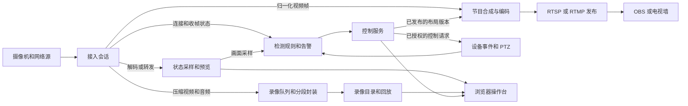

# 综合视频监控台设计

首版面向单站点、单节点的值班场景，采用 Windows 或 Linux 服务和浏览器操作台。值班员可以巡看、定位异常、确认告警并回看相关录像。电视墙和 OBS 消费单独配置的节目画面。本文定义拟实现的应用边界，接口及验收指标为设计约定。本机 RTSP 巡看和故障前录像已接通，具体范围见[当前监控程序](../../streaming/monitor/README.md)。

## 架构与现有能力

应用层持有设备台账、会话策略、告警、录像目录和布局。媒体库通过已有公开 API 接入。首版采用同一服务内的独立任务和有界队列，便于在同一节点复用输入。跨进程媒体服务适合已有网关的部署，但需要另外处理网络开销、进程间的时间映射和恢复。直接扩展现有 YAML 图适合固定转码任务。当前 Pipeline 的多输出依次同步写入且共用失败域，适合一起成功或失败的目的端。监控台需要预览、归档和发布各自隔离，因此由应用层调度。 [Pipeline 输出契约](../../streaming/pipeline/README.md)

| 模块 | 已有入口 | 监控应用需补齐 |
| --- | --- | --- |
| 设备和媒体接入 | RTSP 协议及服务端适配、FFmpeg URL 接入、`TurboMedia::MediaRuntime` 的媒体源注册和发布 | 主动拉流会话、设备能力探测、重连与每路时间映射 |
| 实时画面 | Pipeline 合成器支持带位置、尺寸、透明度的图层和辅路帧提交 | 将解码帧接入共享时间轴，构建值班预览和固定节奏的节目画布 |
| 归档 | 容器封装和现有 `turbo_recorder` 接口 | 分段、目录索引、留存、磁盘配额和重启修复 |
| 控制和传输 | 现有 Chttp 服务模式、WebRTC 播放路径及 RTSP、RTMP 输出 | 设备、告警、布局和录像的授权接口，预览与节目发布的控制 |

[MediaRuntime](../../media/runtime/include/turbo_media_source.h) · [合成器](../../streaming/pipeline/include/turbo_pipeline_compositor.h) · [录像接口](../../webrtc/include/turbo_recorder.h) · [RTSP 适配器](../../streaming/rtsp/rtsp_server_adapter.c) · [RTMP 输出](../../examples/ffmpeg_pipeline.yml)

## 设备接入与时间轴

- 每路由一个接入会话管理连接、解码、视频规格和重连。相同设备上同一流规格复用一个拉流会话。网格优先取已配置的低码率子流，放大和录像可引用主流。摄像机支持哪些子流和控制能力由探测结果决定。会话状态为 `CONNECTING → LIVE → RETRY_WAIT → CONNECTING`。明确停用或认证失败分别报告 `DISABLED` 或 `AUTH_FAILED`。仅临时网络故障按有界指数退避重连。
- 设备 ID 稳定。每次建立新连接分配新的 `generation`。监听、解码、录像和导播控制都携带该代次。连接重建或编码参数改变时结束旧区段。延迟到达的旧回调和已排队的旧控制命令在应用前校验代次。辅路重连时由适配器在共同时轴上更新映射。合成器仍按既有契约从队列选取最近已到期的帧。过期后显示该源配置的占位或黑底。
- 间隔和超时使用单调时钟。每连接把源 PTS 和时钟映射到站点时间，支持时使用经验证的设备时钟或 RTP/RTCP 时间关系，否则使用接收时间估计。录像索引保存 UTC、源时间基、映射代次、时间来源及可估计误差。UTC 校时跳变开启新映射区段，避免改变已录区段的时序。多路回放以 UTC 对齐，显式标记缺口和低可信对齐。

## 操作台与节目画面

| 视图 | 用户操作 | 媒体行为 |
| --- | --- | --- |
| 值班网格 | 拖放、分组、轮巡、双击放大、锁定现场画面 | 浏览器渲染通道名、连接状态、音量和告警徽标。可见格子按预算订阅预览流，切页时及时释放订阅。 |
| 告警和回放 | 点击告警定位对应通道，切换到事发时刻，按权限接管 PTZ | 录像播放器使用独立会话，回看和导出期间实时网格可继续接收。 |
| 预监和节目 | 从预设创建布局，先预监，再发布。预设包括画布和各图层的 `source_id`、矩形、透明度及顺序。 | 节目按独立时钟生成固定帧率输出。单路掉线时其图层到期并显示占位，其他格子继续出画。OBS 通过 RTSP 拉节目流，RTMP 可送至媒体服务。 |

预设采用版本号。位置调整调用现有 `turbo_pipeline_compositor_set_positions()`，在一帧内更新全部坐标。改变来源、尺寸、透明度或叠放顺序时，先准备新的合成器和节目代次，确认首个可用画面后再启用。准备失败时原节目继续输出。若要在同一会话内平滑切换，输出端需验证编码参数兼容并从关键帧切入。分辨率或编码格式改变则给出重新连接状态。首版最多接纳一个运行版本和一个待启用版本，两者均占用明确的内存及编码预算。

节目时钟与输入解耦需要新增一个固定节奏的应用画布供给适配。现有合成器跟随绑定 Pipeline 的主视频帧，工程验证可以先使用一条明确的参考源驱动。随后用稳定画布作为主路，把原主摄像机也作为画布上的输入。值班告警提示和摄像机标签在操作台独立绘制。对外节目图层仅包含发布确认的内容。 [合成时间轴和位置更新](../../streaming/pipeline/docs/video-compositor-design-zh.md)

## 状态检测与告警

每路采样记录 `last_packet`、`last_decoded_frame`、`last_preview_frame`、解码失败、重连次数、队列丢帧和时钟质量。只在对应分支处于启用状态且预期产帧时计算该项超时。节目发布单独记录编码进度、最近成功交付时间和输出端错误。值班员据此区分源已掉线、已收包但解码不出帧、预览积压及发布失败。

| 事件 | 判定与恢复 |
| --- | --- |
| 断流 | 已启用的源超过其配置的收包窗口仍未收到新包，且连接不在初始化宽限期。连续收到有效包后恢复收包状态，解码异常由自己的规则独立恢复。 |
| 解码异常 | 包继续到达，解码超过阈值未成功或连续报错。重新产出有效帧后恢复。 |
| 疑似冻结 | 在持续收到新帧的前提下，对降采样亮度比较内容变化，连续低于阈值达到窗口才提示。可按机位关闭或调整检测，低运动画面仍由值班员复核。 |
| 黑屏 | 对有效画面采样，暗区比例持续超过阈值时提示。夜景等机位使用独立阈值或停用这条规则。 |
| 存档或发布故障 | 录像队列满、磁盘满、节目输出超时等故障归到对应分支。恢复时保留不可回放的时间缺口和失败原因。 |

检测状态与人工处置分别持久化。每个 `source_id + rule_id` 只有一条未恢复异常，重复命中更新最后观测时间和次数。首次出现、恢复、指派、确认、备注、关闭写独立事件。同一次异常的断线重连仍能更新原告警。恢复只更新信号状态，告警确认和关闭由值班员操作。一次处置提交在同一事务中保存告警版本、操作记录和可重放的变更序号。并发提交以版本冲突提示刷新，重试同一操作 ID 返回原结果。

## 录像与回溯

源录像录入各路已有的压缩轨，节目录像记录合成后的独立轨。源录像分支在解码前取得有序、可保留的编码单元，保留区段起始解码所需的关键帧和 codec 配置。段长和切分上限可配置。重连、编码参数变化或数据缺失打开新段。容量耗尽时结束当期可用前缀、记录缺口，在空间恢复后从下一可解码关键帧重开。文件编号和片段读取权由录像任务管理。

1. 写入临时段并完成封装。先刷新媒体文件，再持久化待提交目录行，记录来源、时间范围、路径和段完整性。
2. 在同一卷内原子发布文件名。确认文件已发布后，将目录行置为可查询。服务重启按待提交行核对最终文件或临时文件，完成提交或标记缺口。异常中止的半段只在修复并校验成功后加入目录。
3. 回放和导出通过片段 ID 获取有期限的读引用。清理任务先标记待删除，待读引用释放后删除文件并提交结果。保留策略同时检查时间、总配额和已保全事件。告警保存配置的前后时间窗。多个告警重用同一段的引用，范围未录制时仍可显示告警和缺口。

首版采用本机媒体目录和应用专用 SQLite 数据库，持久化索引、告警、布局及审计。SQLite 是拟新增的应用层依赖。它为单机索引提供事务和查询能力，部署只需管理本机数据文件。已有共享数据库的多站点部署可在需要时重新评估目录后端及迁移。单写任务按事务更新，短查询使用独立读连接。元数据库使用本地文件系统，部署时限制写队列、读事务时长及恢复耗时，并监测 WAL 及检查点进度。数据库与媒体盘分别留出管理空间。数据库不可用时，媒体预览继续运行，界面明确提示告警记录或操作提交受限。 [SQLite WAL 并发与部署约束](https://sqlite.org/wal.html)

## 控制接口与操作权限

浏览器通过 Chttp 控制服务读取快照和小批量变更，通过独立媒体会话接收画面。首版使用分页增量查询。有变更序号缺口或超过保留窗时重新取快照。后续可用 WebSocket 提醒客户端读取增量。HTTP 回调只做鉴权、校验和有界提交，耗时事务及媒体 I/O 交给各自的任务。

| 接口草案 | 契约 |
| --- | --- |
| `GET /v1/sources` 和 `GET /v1/changes?after=…` | 返回授权范围内的快照或游标增量，含状态和更新时间。 |
| `POST /v1/incidents/{id}/actions` | 提交确认、指派、备注或关闭，携带操作 ID 和预期版本。只在事务成功后返回已提交。 |
| `PUT /v1/layouts/{id}` 和 `POST /v1/programs/{id}/activate` | 保存版本，发布指定版本，返回准备任务 ID。通过状态接口查询首帧就绪、已启用或失败。 |
| `GET /v1/timeline?source=…&from=…&to=…` | 返回录像区段、缺口及时间置信度。下载按授权的片段 ID 打开有限时长的读会话。 |
| `POST /v1/sources/{id}/ptz` | 仅允许已授权摄像机。每台设备串行控制，支持设备侧超时的机型才接纳连续移动。客户端离开或本地超时时发送停止命令。设备响应未知时提示核实，保留命令与结果审计。 |

只读用户只能巡看已授权分组。值班员可确认告警和操作已授权设备。管理权限控制接入、发布、导出和留存。节目输出发布也检查图层来源权限。摄像机账号保存为服务端凭据引用，媒体地址在界面和诊断日志中脱敏。操作审计记录操作者、对象、时间和结果。普通日志在异常状态变化时使用 `tlog`，逐帧和丢包使用计数器及周期摘要。ONVIF Profile T 用于兼容设备的 PTZ、媒体和基础事件，Profile G 可扩展设备侧录像检索，Profile M 供后续对接分析事件。 [ONVIF T](https://www.onvif.org/profiles/profile-t/) · [ONVIF G](https://www.onvif.org/profiles/profile-g/) · [ONVIF M](https://www.onvif.org/profiles/profile-m/)

## 队列与资源预算

| 路径 | 所有权和满载行为 |
| --- | --- |
| 接入到预览 | 每源单生产者和一个预览消费端。保留最新已解码帧，替换尚未领取的旧帧，正在使用的帧通过持有引用保活。若全是已领取帧，拒绝新输入并计数。 |
| 接入到录像 | 每条有界队列有独立消费任务。已接纳的数据按顺序排空，达到包数或字节上限后报告缺口，并仅停止该录制分支的接纳。 |
| 解码到合成 | 每个输入源单生产者，合成线程为唯一消费者。复用合成器的固定槽位和时间戳选帧。满载返回背压，实时调用方可主动跳过当前未接纳帧并计数。 |
| 编码到发布 | 每个目的端独立任务、写入期限和队列。持续积压时报告目的端异常并重建该端会话。恢复时提供有效的编解码配置并从关键帧续发。 |
| 告警和操作 | 数据库写队列以及活动规则数都有上限。长时不可用显式告警并统计。每路运行状态可继续刷新，持久化恢复后按当前状态核对并记录缺失窗口。操作未提交则明确返回失败或可查询的受理状态。 |

媒体回调中的借用数据在返回前完成拷贝或取得独立有效的引用。当前 MediaRuntime 的发布回调同步执行，某订阅回调失败可能提前结束后续交付。若用它接入监控扇出，由一个应用订阅回调向相互隔离的队列提交，记录每个分支的入队结果。关闭时先停止新接纳，再停止输入生产并等待在途回调结束，随后排空归档、关闭各输出并释放借用对象。 [媒体源实现](../../media/runtime/media_source.c) · [现有有界扇出契约](streamgraph-v2-fanout-owner.md)

容量按码率、路数、保留时长和实际 stride 配置。以 8 路各 4 Mbit/s 为例，全天源录像约为 345.6 GB，按 7 天约为 2.42 TB，另计节目录像、容器开销和预留空间。8 路 1080p I420 各保留 3 个紧凑帧槽，原始像素约 71.2 MiB，实际还包括行对齐、缩放缓冲、解码器和队列。以上为容量计算。吞吐、并发预览数和端到端延迟由目标部署机器测量。

## 交付顺序与验收

1. **巡看与检测**。接入 4 路 RTSP 测试源，支持分组、保存布局、状态显示、断流及疑似冻结。拔掉一路后，其它画面继续播放。恢复时同一异常记录状态更新。模拟旧代次回调、时钟跳变和快速重连。
2. **告警与录像**。单机分段归档、告警跳转实时与历史、确认和导出。验证写满磁盘、重启发生在改名或事务边界、读取期间保留清理。录制故障在时间线上显示缺口，预览持续可用。两个值班员同时操作时只提交一次状态变更。
3. **对外发布与控制**。接入独立节目时钟、预监与发布、RTSP/RTMP 输出和 ONVIF PTZ。让 OBS 接收实际合成画面并核对输出内容。断开一路来源或暂停接收端，验证剩余画面、告警及原始录像的独立进度。用实测持续运行结果决定各项配额。

迁移从已经运行的 Pipeline 或 RTSP 输出开始，按设备逐组导入监控配置。原有图配置可并行保留。上线前导出布局和设备清单并备份归档目录。回滚时把播放地址切回原有媒体服务，独立停用监控应用，将目录和录像保留作只读回溯。
