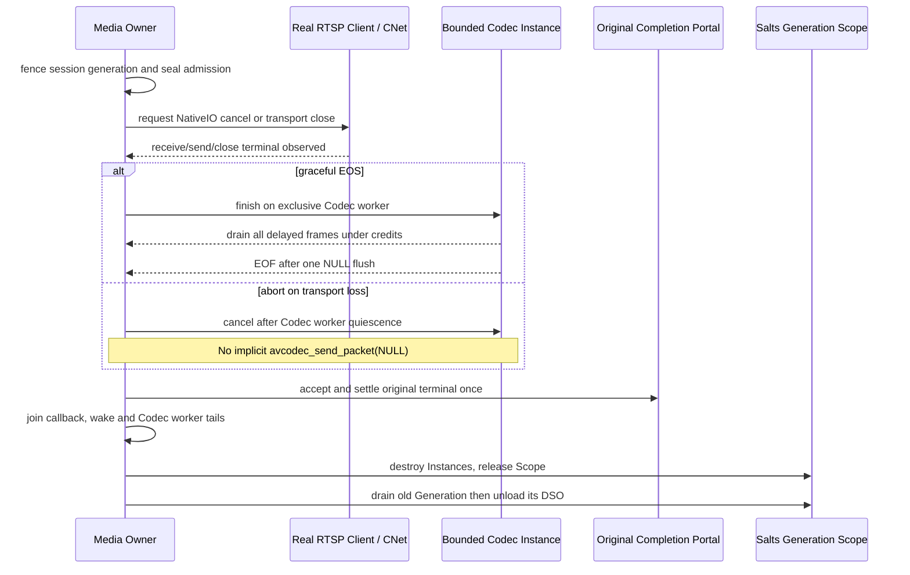

# StreamGraph M15d — Real RTSP NativeIO cancellation and Codec ownership

Tracks [#192](https://github.com/qigao/turbomedia/issues/192), parent [#166](https://github.com/qigao/turbomedia/issues/166), [#165](https://github.com/qigao/turbomedia/issues/165), [#190](https://github.com/qigao/turbomedia/issues/190).

This is stacked on Draft [#187](https://github.com/qigao/turbomedia/pull/187). **DO NOT MERGE**.

## Current cross-repository ownership

- **RTSP control and RTP framing**: existing `TurboMedia::RTSP` with Salts `CNet` NativeIO. CNet owns real TCP, UDP or KCP endpoints; the RTSP Client/Server owns control requests and interleaved framing. `turbo_rtsp_client_close()` closes its NativeIO session and clears RTSP receive/frame buffers.
- **Decoded video**: the optional desktop FFmpeg addon owns per-Instance `tm_ffd_decoder` (bounded packet copies, MPEG-2 delayed frames, one NULL flush). RTSP must NOT call this Codec concurrently with another Codec worker.
- **Media Owner**: the one authority over RTSP admission, Codec finish/cancel, Portal terminal reconciliation, StreamGraph FrameStore effects, and eventual Generation Scope release.
- **DSO and Scope**: only the real Salts ComponentPlugin loader controls Module/Generation lifetime. A borrowed CMeta Service remains valid only while its actual address-stable Scope is live. No second dynamic loader, hidden executor, auto-retry, or persisted raw runtime state.

## Required shutdown ordering

## Initial executable gate in this branch

`tests/test_rtsp.c` now tests a **real** localhost CNet TCP RTSP server/client sequence with two consecutive `ANNOUNCE -> SETUP -> RECORD` sessions. An interleaved RTP frame is sent in the first session, then the original CNet client is closed *without first reading its echo*. The same client storage is reconnected; the second session sends distinct RTP bytes and must receive only its own echo. Calls to send/receive/TEARDOWN on the retired handle must fail. No in-memory substitute, hand-rolled RTSP socket, or simulated deadline.

The preflight now has a stronger **real callback overlap**: after the server's CNet transport has delivered RTP into the genuine `on_interleaved_frame` callback, an atomic gate holds its borrowed Session stack. The Media Owner closes the **separate** RTSP Client/CNet owner while the server callback remains active; only then does it release the callback and observe its exit. Both atomic gates have monotonic-clock watchdogs. A subsequent connection reusing the client object must receive only its own distinct RTP bytes; old-session Send/Receive/TEARDOWN all reject. This is not based on an estimated sleep and does not require manually fabricating a CNet completion.

**Precise limitation:** this proves a real server-side RTP callback overlapping a remote client's NativeIO close and the absence of stale interleaved RTP after reconnection. It is not yet the harder case of *the very same client NativeIO completion callback* concurrently being cancelled, nor does it establish that an RTSP callback and the MPEG-2 Codec worker overlap in a single Source. No fake Codec flush is performed on this abort path. `turbo_rtsp_client_close` remains exclusively owned by its client caller; no test accesses the same RTSP Client concurrently from two threads.

## Actual CNet callback-initiated close (M15d acceptance increment)

The CNet progress owner retains its authority even when a genuine NativeIO receive completion invokes an inline observer. A new `tests/test_rtsp.c` gate connects to the **real localhost RTSP server** and issues an actual OPTIONS command over Salts CNet. Inside the resulting genuine `cnet_observer.on_receive` callback, the same owner calls `cnet_close` on the connection whose receive completion is being dispatched. This exercises CNet's documented **callback-admission deferral**: there can be only one CLOSE terminal for the old Generation and no CLOSED callback may execute recursively while the receive observer still holds the original stack.

The test verifies that the old CNet handle becomes permanently stale, the bounded one-slot owner recycles its slot with a different Generation and that a new OPTIONS request reaches only the new observer. The original Receive callback is distinct from a test-only pre-call hook: it is reached by actual RTSP bytes delivered from NativeIO. All CNet admission and `cnet_client_poll` calls remain strictly on a **single Owner thread**, satisfying the library's no-concurrent-progress contract.

**Not yet demonstrated:** a kernel completion being queued in NativeIO at precisely the same instant as an Owner close request before callback dispatch, RTP media from an RTSP session entering an installed multi-packet delayed Codec DSO, or live RTSP/RTP-to-Codec abort vs graceful EOF. Those are separate acceptance gates, not inferred from this callback-close scenario.

## Qualified first RTP-to-Codec bridge (M15d incremental gate)

The existing RTSP parser had a **MPEG-2 Transport Stream** RTP helper (PT 33, 188-byte TS packets), which is *not* the MPEG-2 Video **Elementary Stream** accepted by the optional `tm_ffd_decoder` Source. M15d adds a separate RFC 2250 MPEG Video RTP payload view (`turbo_rtsp_mpeg_video_payload_parse`) with explicit type/PTS ownership. It rejects reserved header bits, unsupported optional MPEG-2 picture extension `T=1`, invalid AN/N signaling and unsupported picture types instead of silently treating TS or extensions as elementary video. A parser success does not authorize partial-picture admission.

The incremental test-only bridge `tests/test_rtsp_mpeg_video_codec.inc` uses the **real RTSP Server/Client and Salts CNet NativeIO**, not a synthetic callback. A deterministic FFmpeg MPEG-2 encoder creates 12 distinct CPU frames with genuine B-picture reordering. The test wraps each encoded ES picture in a one-packet RTP/AVP **PT 32**, 90-kHz PTS and four-byte RFC 2250 header, transmits it over interleaved RTSP RECORD to the live server and accepts only the actual RTP echoed back to the single Media Owner. It validates exact RTP channel, Session epoch, PT, SSRC, sequence, PTS tick alignment, RTP marker, and complete B/E picture flags before calling the existing bounded `tm_ffd_submit` implementation. Submitted wire storage is overwritten immediately to verify deep packet copies. The test drives the Decoder explicitly and verifies all 12 display-order luma frames, delayed frames after one NULL Flush, and final EOF, with **no invented RTP DTS** (`AV_NOPTS_VALUE`).

The abort control establishes a new real RTSP Session and Decoder generation, rejects a stale epoch and wrong channel before Codec admission, admits two complete packets, then closes the real CNet-backed RTSP Client *without TEARDOWN* and calls `tm_ffd_cancel`. It must leave `flush_sends=0`, zero outstanding compressed buffers and no decoded frame. No Codec context is accessed concurrently: RTSP receive and Codec calls are owner-serialized.

**Deliberate limits:** the bridge is **test-owned**, compiling the exact optional FFmpeg delayed Source file into the platform test without shipping a new service ABI or invoking a second Codec implementation. It supports only the one-complete-picture-per-RTP-packet, `T=0` MPEG-2 profile at fixed 30 fps with bounded bytes. Fragmentation/reassembly, RTP timestamp rollover, lost/reordered network packets, real RTP input from an external camera, multi-Codec negotiation, the installed CMeta Provider Portal/Generation Scope and fully sanitizer-instrumented dependencies are separate gates. No claim of complete RTSP integration until those are qualified.

## Next mandatory integration gate

A true source/codec bridge must accept actual RTP payloads with an explicitly negotiated supported depacketizer and Codec profile. Bind CNet completion identities to one RTSP Session Generation and one bounded Codec Instance. Reject mixed/unsupported codec/profile before RTP admission. Hold the original Scope through worker and CNet close quiescence. Test both graceful EOS (all delayed frames under two ordered-lossless sinks and single NULL flush) and abort (drop undecoded input, no flush, no frame effect). Add a deterministic barrier for a NativeIO completion racing with cancel, not a sleep-based surrogate. Add installed SDK consumer and sanitizer jobs against **actual RTSP/FFmpeg** execution, not merely a syntax contract.

## Release claims excluded

The RTSP test here does not prove real media depacketization, live FFmpeg RTSP demux, RTSP receive callback concurrently in progress during close, or GmSSL TLS/RTSPS. Do not mark M15d complete until those gates are present. #165/#166/#180/#190/#192 stay Open; all stacked PRs stay Draft and `master` remains unchanged.
