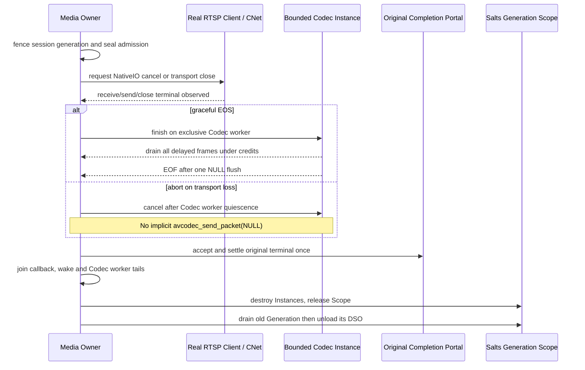

# StreamGraph M15d — Real RTSP NativeIO cancellation and Codec ownership

Tracks [#192](https://github.com/qigao/turbomedia/issues/192), parent [#166](https://github.com/qigao/turbomedia/issues/166), [#165](https://github.com/qigao/turbomedia/issues/165), [#190](https://github.com/qigao/turbomedia/issues/190).

This is stacked on Draft [#187](https://github.com/qigao/turbomedia/pull/187). **DO NOT MERGE**.

## Current cross-repository ownership

- **RTSP control and RTP framing**: existing `TurboMedia::RTSP` with Salts `CNet` NativeIO. CNet owns real TCP, UDP or KCP endpoints; the RTSP Client/Server owns control requests and interleaved framing. `turbo_rtsp_client_close()` closes its NativeIO session and clears RTSP receive/frame buffers.
- **Decoded video**: the optional desktop FFmpeg addon owns per-Instance `tm_ffd_decoder` (bounded packet copies, MPEG-2 delayed frames, one NULL flush). RTSP must NOT call this Codec concurrently with another Codec worker.
- **Media Owner**: the one authority over RTSP admission, Codec finish/cancel, Portal terminal reconciliation, StreamGraph FrameStore effects, and eventual Generation Scope release.
- **DSO and Scope**: only the real Salts ComponentPlugin loader controls Module/Generation lifetime. A borrowed CMeta Service remains valid only while its actual address-stable Scope is live. No second dynamic loader, hidden executor, auto-retry, or persisted raw runtime state.

## Required shutdown ordering

## Initial executable gate in this branch

`tests/test_rtsp.c` now tests a **real** localhost CNet TCP RTSP server/client sequence with two consecutive `ANNOUNCE -> SETUP -> RECORD` sessions. An interleaved RTP frame is sent in the first session, then the original CNet client is closed *without first reading its echo*. The same client storage is reconnected; the second session sends distinct RTP bytes and must receive only its own echo. Calls to send/receive/TEARDOWN on the retired handle must fail. No in-memory substitute, hand-rolled RTSP socket, or simulated deadline.

The preflight now has a stronger **real callback overlap**: after the server's CNet transport has delivered RTP into the genuine `on_interleaved_frame` callback, an atomic gate holds its borrowed Session stack. The Media Owner closes the **separate** RTSP Client/CNet owner while the server callback remains active; only then does it release the callback and observe its exit. Both atomic gates have monotonic-clock watchdogs. A subsequent connection reusing the client object must receive only its own distinct RTP bytes; old-session Send/Receive/TEARDOWN all reject. This is not based on an estimated sleep and does not require manually fabricating a CNet completion.

**Precise limitation:** this proves a real server-side RTP callback overlapping a remote client's NativeIO close and the absence of stale interleaved RTP after reconnection. It is not yet the harder case of *the very same client NativeIO completion callback* concurrently being cancelled, nor does it establish that an RTSP callback and the MPEG-2 Codec worker overlap in a single Source. No fake Codec flush is performed on this abort path. `turbo_rtsp_client_close` remains exclusively owned by its client caller; no test accesses the same RTSP Client concurrently from two threads.

## Next mandatory integration gate

A true source/codec bridge must accept actual RTP payloads with an explicitly negotiated supported depacketizer and Codec profile. Bind CNet completion identities to one RTSP Session Generation and one bounded Codec Instance. Reject mixed/unsupported codec/profile before RTP admission. Hold the original Scope through worker and CNet close quiescence. Test both graceful EOS (all delayed frames under two ordered-lossless sinks and single NULL flush) and abort (drop undecoded input, no flush, no frame effect). Add a deterministic barrier for a NativeIO completion racing with cancel, not a sleep-based surrogate. Add installed SDK consumer and sanitizer jobs against **actual RTSP/FFmpeg** execution, not merely a syntax contract.

## Release claims excluded

The RTSP test here does not prove real media depacketization, live FFmpeg RTSP demux, RTSP receive callback concurrently in progress during close, or GmSSL TLS/RTSPS. Do not mark M15d complete until those gates are present. #165/#166/#180/#190/#192 stay Open; all stacked PRs stay Draft and `master` remains unchanged.
