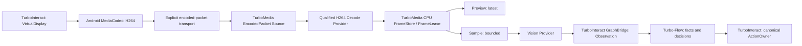

# M17 — TurboMedia StreamGraph usage for Android screen/video

**Status: M17a typed plan contract only. Not a runnable Android H.264 Graph.**
Track [#275](https://github.com/qigao/turbomedia/issues/275);
upstream Graph [#162](https://github.com/qigao/turbomedia/issues/162),
Provider migration [#166](https://github.com/qigao/turbomedia/issues/166),
Vision [#167](https://github.com/qigao/turbomedia/issues/167),
downstream [TurboInteract #4](https://github.com/qigao/turbo-interact/issues/4).

TurboMedia M16 integrated its 19 stacked StreamGraph v2 implementation commit layers into master; historical Closed/Unmerged Draft PR metadata does not erase the
code integrated by fast-forward. Reuse the actual mainline Graph, not a
second scheduler, decoder implementation, FrameStore or GraphBridge owner.

## Graph ownership and data flow

**Diagram = target, not all implemented.** TurboInteract owns Android
authentication, session, VirtualDisplay and ActionOwner. Its current
`AndroidH264Capture` produces MediaCodec packets. That existing capture
implementation can be moved/adapted as a TurboMedia Android Source Provider,
without copying MediaCodec or introducing an alternate encoder. The actual
device side is an authorized source; TurboMedia owns Graph execution and
codec state after packet admission. Turbo-Flow receives small immutable facts,
**never frame buffers or actionable hardware authority**.

## What can be used today

| Product API | Proven functionality | Not yet proven |
| --- | --- | --- |
| `tm_sg_compile` | Six typed port kinds, immutable graph preflight, format/schema/timebase/memory checks | Codec or Source factory resolution, Graph execution |
| `tm_fs_publish_cpu` / `reserve_pin` / `acquire_pinned` | CPU copy to bounded FrameStore, generation-fenced lease/pin | GPU zero-copy, remote FrameRef |
| `tm_fo_submit` / `take` / `settle` | ordered.lossless, latest, sample branch admission | Arbitrary compressed + decoded DAG |
| `tm_ex_create` / `pump_source` / `pump_sink` | One CPU VideoFrame Source, 1–8 read-only Processors, 1–8 Sinks | H264 EncodedPacket→decode, Observation output or A/V mux fan-in |
| `tm_ho_*` / `tm_od_*` / `tm_pc_*` | Bounded owner handoff, completion and cancellation | A second automatic event-loop scheduler |
| `tm_ff_submit_mjpeg` (optional desktop) | Actual MJPEG→CPU luma libavcodec profile | Generic H264 input, AAC/Opus, all-platform FFmpeg |

**M17a has an executable CTest of the actual graph compiler**, inside the
existing `streamgraph/tests/test_contract.c` test target. It constructs:
`Android EncodedPacket(H264 fixture, 1/1000000) → explicit Decode →
VideoFrame(I420 fixture) → Preview + Sample→Vision→Observation`.
It checks that implicit EncodedPacket→VideoFrame, wrong codec format,
wrong timebase, GPU→CPU without explicit conversion and mismatched
Observation schema all fail compile. These fixture-local format IDs are
**not** a shipped codec/pixel registry and named nodes are **not** bound
or runnable Provider factories. Do not call the current CPU Executor on
that heterogeneous plan and claim it supports H264.

## M17b implemented: immutable metadata in CPU FrameStore

The v1 `tm_fs_frame_ref_v1`, `turbo_codec_ops_t` and
`tm_ex_binding_v1` layouts are unchanged. The additive
`tm_fs_frame_metadata_v1` carries exact device/display/session/geometry,
capture-session and stream incarnations, packet sequence, frame format,
width/height, timebase and PTS/DTS. The FrameStore now exposes
`tm_fs_publish_cpu_with_metadata` and exact-Ref
`tm_fs_get_metadata`. Slot retirement clears metadata; a reused slot
returns `TM_FS_ESTALE` for old FrameRef, while legacy published frames
return `TM_FS_ENOMETA`. Reading metadata **does not** retain a frame.

`tm_ex_bind_source_metadata` adds an optional owner-local callback after a
real Source has produced decoded CPU bytes. The Executor copies both bytes
and metadata before publication and preserves them together across
Store/Fanout backpressure, without an extra Codec context or worker. This
is qualified in existing FrameStore/Executor CTests, not a new target.

**M17c real Codec adapter in this Draft:** production
`TurboMedia::StreamGraphH264` binds the existing
`TurboMedia::Codec` OpenH264 decoder, accepting bounded, complete
Annex-B H264 access units. `tm_sgh264_submit` validates exact
`tm_fs_frame_metadata_v1`, capture/display/stream incarnation,
monotonic sequence and PTS=DTS (B-frames explicitly unsupported), codec
config SPS/PPS, IDR/key flags, EOS and buffer size **before** decoder
effects. Decoder state is owner-local; no duplicated H264 implementation,
scheduler or automatic fallback. `tm_sgh264_ready` must be checked
before the existing Executor pumps a Source; config-only
`TM_SGH264_NEED_MORE` is not EOS. The output is fixed I420 via
`tm_sgh264_next_cpu_i420` and `tm_sgh264_source_metadata`,
then actual FrameStore/fanout ownership.

The **existing** `streamgraph_executor` product CTest is augmented only
when building the actual top-level TurboMedia Codec product. It creates
an H264 bitstream with the real TurboMedia Codec encoder, uses the same
OpenH264 decode path, publishes a decoded I420 FrameRef with source
metadata, admits two fanout consumers and reserves a separate delayed
Vision pin before the Processor returns. Nothing is mocked. This
new top-level Codec acceptance still requires a successful real
Platform Build; standalone Graph Core checks cover M17b only, not
the native H264 Codec link. The historical SDK tag/tag-restore 404
tracked by #225 must not be bypassed or reported as a source test failure.

**Real test compilation without an SDK restore workaround:** existing
`StreamGraph typed core contracts` Linux native/ASan jobs now opt into
`TM_STREAMGRAPH_H264_NATIVE_TEST`. It does NOT create another target,
project, executable or decoder algorithm: the original
`codec/codec_registry.c`, `codec/g711_codec.c` and
`codec/h264_codec.c` are linked with the production adapter into the
existing `streamgraph_executor_test` binary using Ubuntu's real
OpenH264 development library. The top-level product instead builds
`TurboMedia::StreamGraphH264` linked to `TurboMedia::Codec`. These
are two different **build closures** for the exact same source and
public callback contracts, not two decoders in one runtime.
No local H264 test replaces independent full-platform SDK qualification.

The v1 decoder additionally requires a Baseline SPS (profile_idc 66), rejecting Main/High streams rather than assuming the sender's PTS=DTS precludes B slices. Existing CTest includes negative profile, frame-budget, DTS, sequence and source-generation cases.

The first profile does **not** support AVCC length-prefixed NAL input,
RTP FU-A/reassembly, GPU/MediaCodec zero-copy, B-frame reordering,
cross-process FrameRef, dynamic geometry or full heterogeneous
EncodedPacket→Vision DAG execution. Such capabilities must be explicitly
added as providers, without silently choosing another decoder.

## Required next additions, not alternative runtimes

**M17b — preserve packet and frame provenance.** Android
`AndroidH264Capture.EncodedPacket` gives bytes, `presentationTimeUs`,
`codecConfig`, `keyFrame` and `endOfStream`, but not an authoritative
cross-device/stream envelope. Explicitly carry or validate session ID,
capture session, display ID and generation, geometry generation, stream
epoch, sequence, codec/profile, Annex-B vs AVC NAL layout, SPS/PPS/IDR,
timebase, PTS/DTS, discontinuity/reconfiguration, EOS and bounded bytes.
Do not conflate presentation time with decode time on B-frame content.

Current `tm_ex_source_next_fn` passes only bytes/size; current
`tm_fs_frame_ref_v1` has Store/slot/source/display identity but no
PTS/DTS, capture-session or geometry-generation. A new **additive,
versioned metadata sidecar** with an explicit owner and lifetime is needed
before production H264. Keep public `turbo_encoded_frame_t` and
`turbo_codec_ops_t` ABI stable. A process-local FrameRef is not a wire
protocol, does not itself retain pixels, and must not cross Android→PC
as an assumption of remote memory lookup.

**M17c — use the existing TurboMedia Codec.** Bind actual
`TurboMedia::Codec` H264/OpenH264 (or an explicitly selected qualified
hardware/FFmpeg provider) to an EncodedPacket Source and CPU
VideoFrame output. One Media Owner invokes mutable decoder operations,
using current Handoff and ProviderCompletion on callback boundaries.
No backup decoder, FFmpeg/Android auto-fallback or second graph engine.
A full decoded frame is then published/pinned/leased using existing
FrameStore. The current desktop Graph FFmpeg adapter only qualifies
MJPEG→CPU luma; it does **not** provide an H264 Graph adapter yet.

The CPU FrameStore has an **8 MiB per-frame bound** and copies the
published bytes. 1920×1080 I420 is ~3.11 MiB and RGBA ~8.29 MiB,
within that bound, while 4096×2048 I420 is ~12.58 MiB and RGBA
~33.55 MiB, out of range. Larger modes must reject preflight or use a
**qualified explicit** transform; no hidden scaling or false zero-copy.

**M17d — branch-specific ownership.** Preview may use `latest`,
inference `sample`, while recording demands `ordered.lossless`.
Every independently retained or delayed consumer reserves a distinct
FramePin **before queue publication**, releases its lease/pin exactly
once, and fences late results on source/display/model generations.
Recording encoded packets requires a separate typed branch; the current
VideoFrame-only Executor cannot run compressed recording plus decoded
Vision in one generic heterogeneous DAG. This is a runtime gap, not
permission to add a secondary muxer/encoder/scheduler.

An Observation to Turbo-Flow contains bounded typed facts, explicit
model/provenance/correlation and optionally a **weak** FrameRef; an
asynchronous AnalysisRequest must reserve a fresh pin first or reject
STALE_FRAME. ActionIntent enters the **single C11 ActionOwner**, never
executes from Graph code.

## Other TurboMedia Graph applications

- **Video production:** raw VideoFrame → TurboMedia Codec/Encoder →
  EncodedPacket → TurboMedia Muxer/WebM; audio PCM → Opus →
  EncodedPacket → same Muxer. Existing Codec/Muxer/Opus/WebM capabilities
  remain canonical, but StreamGraph arbitrary A/V fan-in, encoder
  ownership and flush/trailer are still separate #166 gates. Do not
  silently redirect production to an unqualified Graph.
- **RTSP/RTC/RTP:** transport Source → depacketize → decode →
  FrameStore/preview/analysis, with explicitly qualified protocol
  Provider and cancellation. Not every existing transport implementation
  is already a StreamGraph Source node.

## No extra CI or false acceptance

M17a uses the existing StreamGraph Core contract CTest and normal product
builds. No installer/consumer test projects, probe CMake/CI, new codec
runtime, emulator or physical-device CI. Real H264 bytes, actual
Source→Codec→FrameStore→Fanout, concurrent input/stop, packet loss,
reconfiguration, metadata and installed SDK integration remain open
in [M17 #275](https://github.com/qigao/turbomedia/issues/275).
