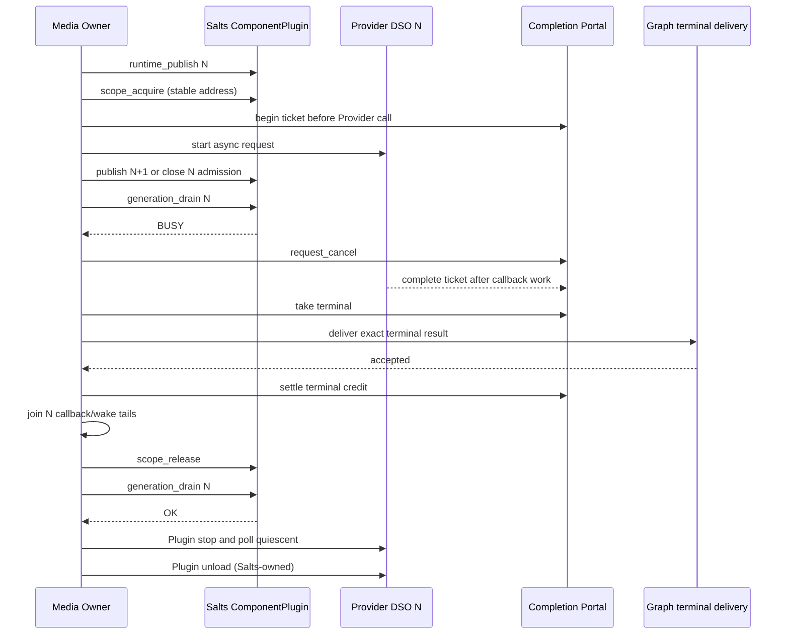

# StreamGraph Provider DSO / Salts ComponentPlugin binding gate

**Status:** partially executable, not yet production-qualified. Parent [#165](https://github.com/qigao/turbomedia/issues/165). Draft stacked after [#178](https://github.com/qigao/turbomedia/pull/178).

## 1. What is actually qualified

`streamgraph_native_provider_dso` compiles two *real* OS-native dynamic libraries whose exported callback entry returns distinct N=101 and N+1=102 generation markers. The host test uses `dlopen/dlsym/dlclose` or Windows `LoadLibrary/GetProcAddress/FreeLibrary` **only inside the test**. It enters an old DSO on a worker thread, holds the function on that thread's real native call stack, requests cancellation of its admitted `tm_pc_portal` ticket, and seals old admission. A second DSO completes independently while N remains in-flight. The old worker is then released, joined, its CANCELLED terminal result settled and finally the native library is unloaded.

The test's *explicit Host gate* refuses unload until:
1. the Portal is sealed;
2. the Portal has no in-flight, cancel-pending, READY or TAKEN credits;
3. all Provider callback/worker threads have terminated and been joined.

The gate tests real native dynamic loading and actual callback threads, not a fake `dlclose` function. Its local unload check, however, **does not use Salts ComponentPlugin**; it cannot prove that the real Salts generation object holds the correct Plugin lease. It is a test-only prototype and must never be copied into production as a second module loader.

## 2. Exact production ownership to implement

Use the canonical Salts candidate interfaces (currently on `qigao/salts` `feature/cmeta-ace-patterns`):
- `Salts::Plugin` solely owns load, stop, quiescence and DSO unload.
- `Salts::ComponentPlugin` solely owns `salts_component_plugin_runtime`, immutable generation bundles and the scope admission/drain protocol.
- One real, stable, **noncopyable**, **address-stable** `salts_component_plugin_scope` guards each admitted Provider lifetime (a generation-wide retained scope is acceptable only if it covers *every* operation in that generation).
- `tm_pc_portal` owns the finite completion credits; `tm_od_owner` delivers correlated terminal results. Neither is permitted to release the Plugin scope inside a callback, under a lock, or before downstream delivery settles.
- CNet/NativeIO owner keeps its own wake/cancel/in-flight I/O lifetime, and must not be replaced by a StreamGraph poller.

The intended order is:

The exact Salts APIs are `salts_component_plugin_scope_acquire`, `salts_component_plugin_runtime_close` (or `runtime_publish` N+1), `salts_component_plugin_generation_drain`, `salts_component_plugin_scope_release`, and `cmeta_plugin_registry_request_stop / poll_quiescent / unload`. A scope remains live while active Provider callbacks, terminal events and their credits are outstanding. A successfully delivered terminal does **not** imply the callback thread has left the DSO; an explicit join/quiescence proof is still required.

## 3. Installed-Salts integration gate that remains OPEN

- [ ] Use **exact installed** `Salts::ComponentPlugin`, `Salts::Plugin` and StreamGraph SDK targets; no copy of Salts headers into TurboMedia and no embedded alternative Plugin registry.
- [ ] Load a *real Salts Provider export* from a native DSO, build/publish Generation N, acquire a real address-stable Scope, begin Portal ticket and call the borrowed typed Interface.
- [ ] Publish N+1 while a callback of N is executing, verify `generation_drain(N)==BUSY`, `cmeta_plugin_registry_unload(N)==BUSY` and that the old borrowed Interface remains valid.
- [ ] Race cancellation against completion, perform Owner terminal event acceptance/explicit reconciliation, join callback workers and release Scope **once**.
- [ ] Verify `generation_drain(N)==OK` and Plugin unload only after safe release, with N+1 unaffected.
- [ ] Run Windows/Linux/macOS installed C11/C++17 integration and Linux ASan/UBSan, plus true TSan where the installed Salts/StreamGraph runtime supports it.
- [ ] Validate exact SDK ABI/version and no hidden fallback to the test-local loader.

## 4. Safety boundary

`tm_pc_cancel_quiesced` is a statement supplied by the Provider owner, not a fact the Portal can prove; it must not be issued while the Provider can still call back. Portal `drained` and module close are not equivalent to DSO quiescence. No forced `dlclose` on timeout, no automatic Provider restart, no raw callback pointer persistence, and no release of a copied/moved live `salts_component_plugin_scope`.

The native DSO smoke test gives an executable baseline for the eventual installed ComponentPlugin acceptance test; it **does not close #165 or certify Salts ComponentPlugin hot replacement**.
