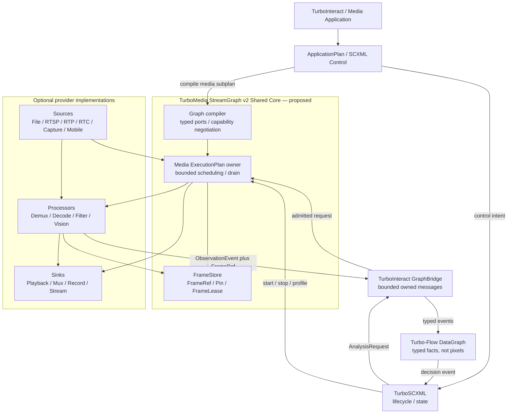
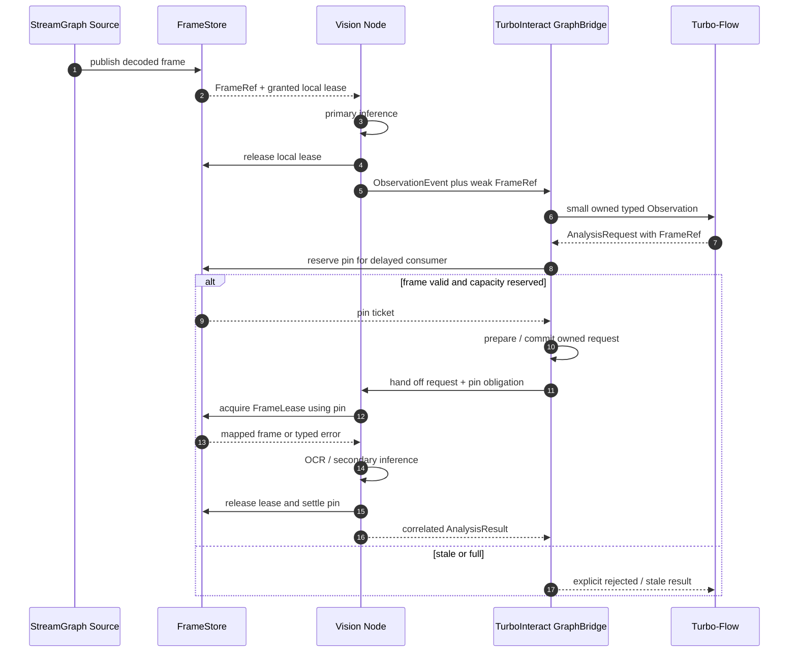

# TurboMedia StreamGraph v2 — unified media execution architecture

**Status:** Review proposal / **not frozen**, **not implemented** (2026-10-12).  
**Tracking:** [#162](https://github.com/qigao/turbomedia/issues/162) with implementation work [#163](https://github.com/qigao/turbomedia/issues/163)–[#167](https://github.com/qigao/turbomedia/issues/167).  
**Consumer:** [TurboInteract #4](https://github.com/qigao/turbo-interact/issues/4).

> The real API is still `pipeline/include/turbo_pipeline.h` and YAML `turbo.media.pipeline/v1`. The C code and YAML below are **API design sketches**, not callable exported symbols or a working configuration. Sources and installed SDKs are the ground truth.

## 1. Why v2, and ownership

TurboMedia already has protocol/media inputs, codecs, filters, HLS, RTP/RTC, capture and playback components. But today's desktop `Pipeline` is a restricted FFmpeg / Runtime-RTP **whole-pipeline** execution mode, while device/RTC/client paths live elsewhere. A general StreamGraph must unify their **typed execution and ownership contracts** rather than copy their implementations into another pipeline.

**One media execution substrate**:
- `TurboMedia::StreamGraph` **Shared Core**, buildable headlessly where its dependencies exist, without FFmpeg, desktop `ServerRuntime`, OpenCV, Android or Turbo-Flow.
- Optional `FFmpeg`, `RuntimeRTP`, `RTC`, `Capture`, `Vision`, `Mobile` **providers** register their own capabilities; each backend depends on Core, not vice versa.
- Existing `TurboMedia::Pipeline` becomes a *client/adapter* compiling into the canonical StreamGraph ExecutionPlan during a deliberate migration; no second permanent graph scheduler or runtime fallback. The v1 public API removal gate must be recorded before release.
- `Turbo-Flow`, `TurboSCXML`, and `TurboInteract` are **downstream**, not dependencies of StreamGraph Core. TurboInteract owns GraphBridge and Action Owner.

### System context



The arrows represent **logical routing**. No callback may recursively advance the foreign Graph or SCXML Session. This does not mandate threads or raw pointer transfers.

## 2. Canonical typed graph and Port negotiation

Graph definition has stable node/port/edge identities, a schema version, immutable provider constraints, explicit budgets and policy. The plan compiler validates DAG topology, type/format compatibility, exact provider binding, track and timebase constraints, security capability and resource ceilings **before** I/O or native resource allocation. A graph that cannot lower into a supported provider topology fails with a structured node/port/reason error.

| Port kind | Data semantics | Main contract |
| --- | --- | --- |
| `ByteStream` | Borrowed/owned byte buffers | Framing, offset, EOF, finite byte budget |
| `RTPPacket` | Encoded transport packet | SSRC/MID/track, sequence, RTP clock, session epoch |
| `EncodedPacket` | Access unit/packet | Codec config, PTS/DTS, timebase, packet ownership |
| `VideoFrame` | Decoded image surface | Dimensions, pixel format, planes, color, clock, memory domain and FrameLease |
| `AudioFrame` | Decoded audio samples | Sample format/rate/layout, sample clock, memory domain and FrameLease |
| `ObservationEvent` | Small structured inference output | Schema ID/version, frame/model identity, geometry, correlation; **no pixels** |

Mixing Port kinds is invalid unless an **explicit** node consumes and produces the relevant kinds (for example `depacketize`, `decode`, `convert`, `infer`). No anonymous `void*` blob as public Graph payload and no implicit GPU->CPU copy. Format conversion and timebase/clock adjustment must be explicit in the plan and observable.

A typed `Source` may be file/URL/RTC/camera/Android capture, but its presence in today's repo **does not automatically mean** it is a StreamGraph v2 provider. Each source is admitted only after its adapter has tests and a declared capability matrix.

## 3. Provider/Node ABI and lifecycle

All public interfaces should be C11 size/versioned, with CMeta typed Component/Interface binding **only when exact ABI and lifecycle are proven**. No new global RTTI/provider-service registry. Provider instances hold codec/model contexts and their own necessary Plugin/DSO generation lease; a caller-facing descriptor is not the owner of an instance.

```c
/* PROPOSED, not a real SDK header; names for contract review only. */
typedef struct turbo_stream_graph turbo_stream_graph;
typedef struct turbo_media_frame_store turbo_media_frame_store;
typedef struct turbo_media_frame_lease turbo_media_frame_lease;

typedef enum tm_port_kind {
    TM_PORT_BYTESTREAM, TM_PORT_RTP_PACKET, TM_PORT_ENCODED_PACKET,
    TM_PORT_VIDEO_FRAME, TM_PORT_AUDIO_FRAME, TM_PORT_OBSERVATION
} tm_port_kind;

typedef struct tm_port_descriptor_v1 {
    uint32_t size;
    uint32_t version;
    uint32_t port_kind;
    uint32_t direction;
    uint64_t schema_id;
    uint64_t capability_bits;
} tm_port_descriptor_v1;

/* Factory instances are created/bound only after immutable plan preflight.
 * prepare/commit are distinct from processing; callbacks are owner-serialized.
 * flush, quiesce, terminal settlement and destroy require declared ordering. */
```

Suggested logical lifecycle:
1. **compile:** parse and canonicalize, resolve immutable provider/port capabilities and limits; no native side effects;
2. **prepare:** create bounded provider/session/edge resources with partial-failure unwind;
3. **start/commit:** publish one owner generation; accept work only after start commit;
4. **run:** media Owner progresses bounded edges; no worker/codec callbacks under foreign locks;
5. **quiesce:** stop new ingress and new frame pins/analysis admission; accepted work remains owned;
6. **drain:** release frame/packet refs, codec flush/trailers and GPU fences; deliver terminal status;
7. **destroy:** only after all owner callbacks, pin credits and DSO generations quiesce.

Explicit unsupported operations must fail at preflight, not fall back to FFmpeg's synchronous scheduler.

## 4. FrameStore as the media-data authority

FrameStore is part of TurboMedia, independent of TurboInteract. It owns finite CPU frame backing and optionally GPU surface/fence resources. Salts `mem_buffer_t` may back CPU memory internally but **does not replace** FrameStore's slot identity, pin admission, GPU synchronization or lifecycle.

- `FrameRef`: immutable identity with `store_id`, `store_generation`, `slot`, `slot_generation`, `frame_id`, `source_session_generation` and `display_generation`. Copying a FrameRef retains **nothing**.
- **Weak lookup:** use FrameRef to attempt acquire, may return `STALE_FRAME` after eviction.
- **Pin ticket:** move-owned *admission credit*, one per asynchronous interested consumer; Store retains backing after valid reservation. Commit transfers obligation; discard or terminal settlement releases it exactly once. A copied numeric ticket does not mint a new credit.
- **FrameLease:** scoped right to map/read a supported CPU/GPU memory domain; cannot outlive pin/acquisition owner. Mapping an incompatible GPU device returns unsupported or requires an **explicit** scheduled conversion node. A fence/pending GPU operation delays retirement; a timeout does not free still-borrowed storage.
- Slot reuse increments slot generation; Store reincarnation increments Store generation. Crash/reboot invalidates all in-process refs. No raw runtime-state persistence.



The **asynchronous request** obtains its pin *before* committing a queued request. The initial observation may carry only a weak FrameRef; if it has already expired before pin reservation, return `STALE_FRAME` and request a new observation. FrameStore does not need to understand Turbo-Flow or SCXML.

## 5. Scheduling, QoS and failure domains

**One mutable owner per codec/provider/session**. The graph may have many owner contexts, but their handoffs use finite queue/credit limits; never claim a shared async event loop without an explicit owner. Memory, queue items, frame count, retained duration, deadline and pending GPU operations are finite plan budgets.

| Edge policy | Admission and saturation | Use case |
| --- | --- | --- |
| `ordered.lossless` | Block within explicit bound / fail branch; never drop committed data | recording, archival, exact packet relay |
| `sample` | Admit configured subset before claim; count sampled frames | inference and analytics |
| `latest` | Coalesce only **unclaimed** frames; do not recycle pinned/leased backing | preview and disposable detection |

Each sink/processor branch declares whether its failure is isolated or propagates upstream, and whether downstream slowness is allowed to throttle its source. Shared decoder errors affect all dependent branches. A sink crash cannot silently truncate recorded output while reporting success. FFmpeg header/packet/trailer lifecycle remains provider-owned with exact first-error reporting; external streaming effects cannot be transactionally rolled back.

## 6. Proposed declarative plan (NOT currently executable)

```yaml
api_version: turbo.media.stream/v2 # proposed, unsupported in current SDK
graph:
  id: android-analysis
  budgets:
    max_nodes: 16
    max_edges: 24
    frame_slots: 12
    max_retained_bytes: 100663296
  nodes:
    - {id: capture, factory: android.screen_source, output: encoded}
    - {id: decode, factory: ffmpeg.decode, media: video}
    - {id: split, factory: frame.tee}
    - {id: preview, factory: frame.preview, qos: latest}
    - {id: sampler, factory: frame.sample, every_n: 3}
    - {id: detect, factory: vision.ncnn, model_id: game-ui}
    - {id: observations, factory: observation.emit}
  edges:
    - {from: capture.encoded, to: decode.in}
    - {from: decode.frame, to: split.in}
    - {from: split.preview, to: preview.in}
    - {from: split.analysis, to: sampler.in}
    - {from: sampler.frame, to: detect.in}
    - {from: detect.observation, to: observations.in}
```

Node names/factories are illustrative; `android.screen_source`, `frame.tee` and `vision.ncnn` **are not presently exported factories**. Build/load the provider only when selected platform and installed dependencies support it.

## 7. Migration, platform matrix and external consumers

Today `ARCHITECTURE.md` places `TurboMedia::Pipeline` in Linux/Windows desktop services, while Capture, RTCClient, Codec and ClientProcessing are shared. Therefore v2 must land as a **platform-neutral Shared Core**. FFmpeg I/O and ServerRuntime remain separately selected capabilities. Android/iOS source providers must integrate without pulling Linux/Windows server dependencies, and some codecs may be unsupported in mobile builds.

Migration dependencies:

| Workstream | Parent | Owner / result |
| --- | --- | --- |
| [M0 typed graph #163](https://github.com/qigao/turbomedia/issues/163) | none | shared core C11 descriptor/graph |
| [M1 FrameStore #164](https://github.com/qigao/turbomedia/issues/164) | M0 for final ABI | credits, leases and ABA |
| [M2 runtime #165](https://github.com/qigao/turbomedia/issues/165) | M0+M1 | bounded owner scheduling/QoS |
| [M3 providers #166](https://github.com/qigao/turbomedia/issues/166) | M0+M2 | FFmpeg/RTP/Capture migration |
| [M4 vision #167](https://github.com/qigao/turbomedia/issues/167) | M1+M2+M3 | typed observation and analysis request |
| [#46](https://github.com/qigao/turbomedia/issues/46), [#47](https://github.com/qigao/turbomedia/issues/47), [#48](https://github.com/qigao/turbomedia/issues/48), [#49](https://github.com/qigao/turbomedia/issues/49) | existing | deepening RTP, DAG, output variants, reconfiguration |
| [TurboInteract #4](https://github.com/qigao/turbo-interact/issues/4) | upstream SDK | installed consumer conformance |

**No legacy scheduler:** if the team retains a v1 authoring parser during transition, it must compile into one canonical v2 execution plan; never run v1 FFmpeg scheduler as fallback. Version cutover/removal, tests and consumers must be explicit.

## 8. What “design complete” means

This document is a **review candidate**, not a frozen interface. Design freeze requires:
1. Typed Port matrix and concrete provider ABI layout signed off by TurboMedia/RTC/Android consumers.
2. FrameStore/Pin/Lease ownership with stop, GPU fences and process-boundary limitations demonstrated by executable fake-store interleavings.
3. Executor owner topology / credit handoff contract and per-branch QoS/error-drain semantics reviewed.
4. Versioned configuration with exact preflight error diagnostics and cross-platform capability matrix confirmed.
5. CMake package/component and FFmpeg migration/retirement steps decided; no forced desktop dependencies for core.
6. Mermaid architecture + lifecycle and negative-tests review accepted, then public ABI code may proceed.

Review this document with [ownership/conformance ledger](streamgraph-v2-ownership-conformance.md); it defines exact failure gates and open decisions.