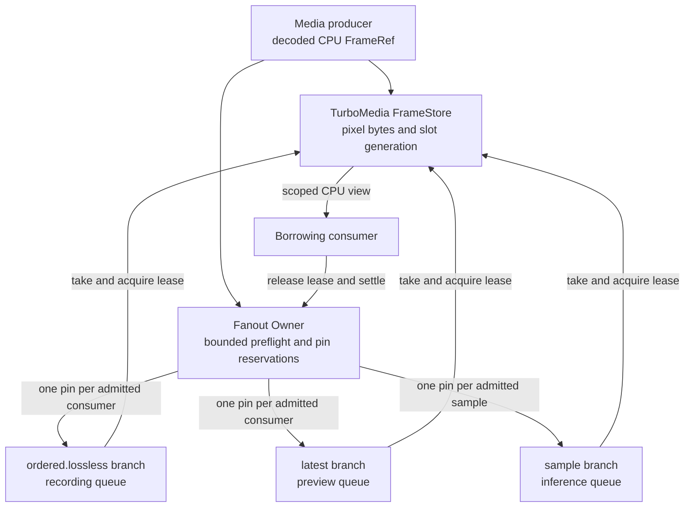
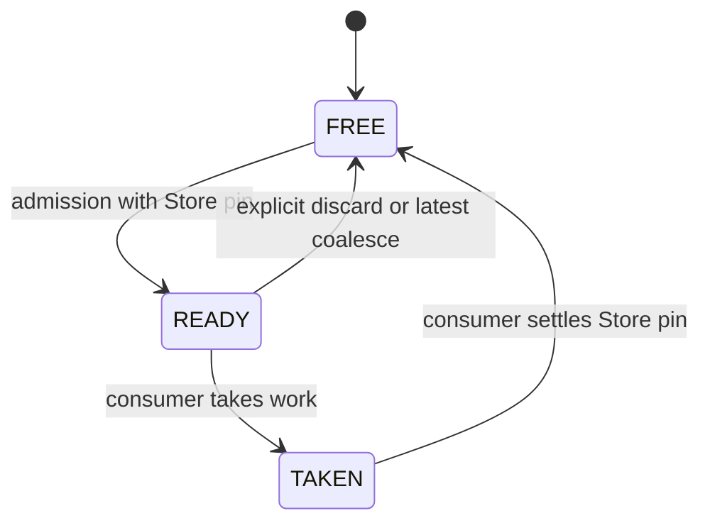

# StreamGraph M2: bounded branch fanout and ownership

**Implementation checkpoint:** [Draft PR #172](https://github.com/qigao/turbomedia/pull/172), tracking [#165](https://github.com/qigao/turbomedia/issues/165). This is a first **single-owner-lane** component, not a full codec scheduler. Its FrameStore comes from stacked [#170](https://github.com/qigao/turbomedia/pull/170).

## One frame, independent consumer pins

The producer calls `tm_fs_publish_cpu` to create one owned backing frame, then `tm_fo_submit` with the returned FrameRef, and may retire the original frame. Every admitted branch holds its *own* FrameStore pin. A READY entry can be withdrawn by its owner only under the declared QoS policy; TAKEN entries are not overwritten. After take, the consumer may acquire a temporary FrameLease and map bytes. A copied FrameRef does not retain memory.

## Branch policy and failure semantics

| Policy | Queue full | Owned effect |
| --- | --- | --- |
| `ordered.lossless` | Refuse entire input before changing other branches | Record exact source-frame order |
| `sample` | Skip unselected IDs deterministically; selected input fails if queue full | Only admitted selections pin frame |
| `latest` | Replace oldest **READY** row, or fail if only TAKEN entries remain | No change to claimed frames |

The reservation order is: check every branch, reserve all selected FrameStore pins, then apply latest READY replacement, finally publish all READY entries. Failed new pin reservation releases the new reservations without publishing. If a latest eviction itself cannot release its pin, the unresolved old row remains owned and the caller receives a failure. The current caller must serialize both Fanout and FrameStore operations on one owner lane.

## Stop, drain and cancellation

`tm_fo_seal` stops admission, but it does not settle accepted work. The owner may discard READY rows; TAKEN rows must be settled by their consumers. `tm_fo_destroy` returns BUSY while either exists. The FrameStore must outlive the fanout and all any remaining mapped leases. A separate FrameStore Destroy still rejects unfinished Pin/Lease ownership.

## Verified scope and missing gates

The test suite exercises three independent branches, ordered recorder under saturation, deterministic sample skip, latest READY eviction, held preview TAKEN rejection, two pin-credit failure rollback, duplicate settle, explicit ready cancellation and seal/destroy refusal. C11 and C++ installed consumers compile against the public header and link the exported symbol.

**Not implemented yet:** media Source/Processor/Sink provider invocation, true concurrent owner handoff/TSan, GPU domain/fences, codec EOS/drain/trailer, FrameStore bytewise zero-copy publishing, streaming container output, or cross-process FrameRef. The Source already copies bytes into the CPU Store on publish; only *fanout* avoids extra copies. Do not claim end-to-end zero-copy.

The next M2 PR must integrate this primitive into the immutable `tm_sg_program` node execution, with explicit queue/owner assignment, ordered EOS and terminal receipts. FFmpeg Pipeline remains in its existing desktop scheduler until the one-way migration tracked by [#166](https://github.com/qigao/turbomedia/issues/166).
