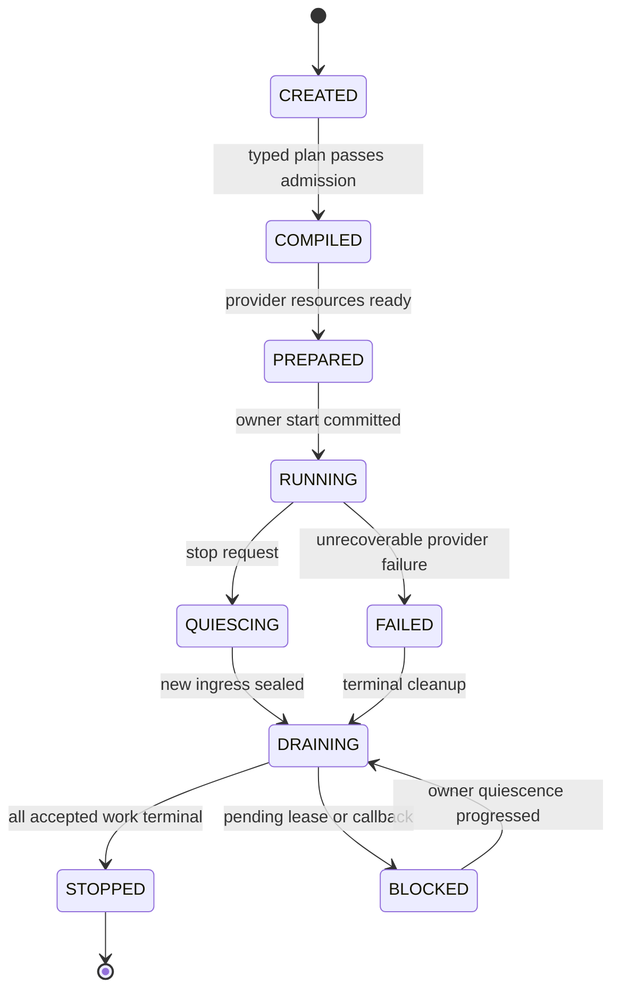

# StreamGraph v2 ownership, concurrency and conformance ledger

**Status:** design proposal, not code qualification. Parent [#162](https://github.com/qigao/turbomedia/issues/162), companion [architecture](streamgraph-v2-architecture.md).

## 1. Authoritative owners and handoff

| Object | Sole authoritative owner | Non-owning consumers | Must be proved |
| --- | --- | --- | --- |
| Immutable compiled graph | Graph compiler / ApplicationPlan admission | Graph Owner, Host | no mutation after commit |
| Codec, filter, Source and Sink sessions | StreamGraph execution owner / provider | host control | callbacks terminate before DSO unload |
| CPU/GPU backing and fences | TurboMedia FrameStore | consumer FrameLease | never recycle leased or pinned slots |
| FramePin credit | FrameStore; temporarily transferred to consumer owner | bridge carries identity | one terminal release per reserved credit |
| ObservationEvent bytes | producing Node until bridge copies | DataGraph/SCXML messages | pointer-free, bounded, schema checked externally |
| Turbo-Flow data state | Turbo-Flow | Media Provider | media thread cannot mutate data state directly |
| SCXML state | TurboSCXML Session/Host | StreamGraph status observer | status does not own media resource |
| Android device effects | TurboInteract Action Owner | Media Graph | no input effects from vision callbacks |

`FrameRef` is a **locator**, not a resource grant. `FramePin` is a **quota-backed lifetime obligation**. `FrameLease` is a scoped **map/use authorization**. These are never interchangeable.

## 2. Pin and frame lifecycle

```mermaid
stateDiagram-v2
    [*] --> FREE
    FREE --> WRITING : writer reserves slot
    WRITING --> READY : publish FrameRef
    WRITING --> FREE : abort write
    READY --> READY : reserve pin credit
    READY --> LEASED : acquire lease
    LEASED --> READY : last active lease released
    READY --> RETIRING : seal new admission
    RETIRING --> FREE : all pins and leases released; fences complete
```



State labels here abstract concurrent pin/lease counts; an implementation **cannot** use a single `LEASED` enum to represent multiple active leases. Retiring forbids new pins but does not revoke valid leases. Cancellation of the last task is not itself proof that a GPU fence has completed.

### Deterministic race schedule

```mermaid
sequenceDiagram
    autonumber
    participant Producer as Media Producer
    participant Store as FrameStore
    participant Bridge as Bridge Owner
    participant Consumer as Secondary Vision
    participant Shutdown as Graph Shutdown

    Producer->>Store: publish frame slot N, generation G
    Producer->>Bridge: enqueue preparation intent
    Bridge->>Store: reserve pin credit
    Store-->>Bridge: pin ticket
    Bridge->>Bridge: prepare/copy request
    Bridge->>Bridge: commit bounded request
    Shutdown->>Store: seal new frame admission
    Consumer->>Bridge: take request and pin
    Consumer->>Store: acquire lease with pin
    Store-->>Consumer: valid FrameLease
    Shutdown->>Store: ask destroy
    Store-->>Shutdown: BUSY; pin and lease remain
    Consumer->>Store: release lease, settle pin
    Store-->>Shutdown: terminal drain is now possible
    Shutdown->>Store: destroy after quiescence
```

On a failed `pin_release` the transfer owner retains a visible obligation; it must not mark the row FREE or retry automatically. A full message queue rejects before commit; no hidden spill or dropping of accepted Action/Analysis control effects.

## 3. Explicit limits and negative conditions

For each ExecutionPlan validate finite:
- source/processor/sink count, ports and edges;
- packet/frame byte ceilings, FrameStore slot count and CPU/GPU retained bytes;
- edge queue items, bytes, duration and sample/latest policy;
- frame pin/lease credit limits and pending GPU fences;
- per-track RTP jitter/reassembly and media clock window;
- context, thread/worker and codec/model instance caps;
- plugin/callback generation and shutdown bounds.

Required negative diagnostics must identify `graph_id`, `node_id`, `port_id`, `error_stage`, `reason`. Unsupported format/domain or provider is **not** a reason to silently substitute CPU, FFmpeg, another codec or a different media Source.

## 4. Owner, drain, cancellation and reconfiguration



This is conceptual, not a promise that every backend has precisely these enums. Graph/FrameStore destruction requires all producers joined, callback lanes quiescent, pending commitments settled and no GPU fences/pin/lease holders. Host stop/cancel **never** blindly destroys the CNet/RTC/FFmpeg owner.

Hot-reconfigure has its own [#49](https://github.com/qigao/turbomedia/issues/49) with candidate graph preparation, one-generation commit boundary and old-generation drain. It is not a prerequisite for initial v2 graph lifetime semantics.

## 5. Conformance acceptance table

| Priority | Witness | Required assertions |
| --- | --- | --- |
| P0 | C11/C++ installed SDK | ABI size/version checks, ownership symbols and capability rejection |
| P0 | Synthetic Source + declared port/type | invalid DAG/format/timebase rejects preflight with no effect |
| P0 | Slot ABA | old FrameRef invalid after slot reuse, Store rebuild, device reconnect |
| P0 | 2+ consumers | independent pin charges, map leases and exact terminal release |
| P0 | Stop/late callback | destroy BUSY until quiescent; no UAF/double release |
| P0 | Bounded edges | full queues fail or declared policy applies; no unbounded storage |
| P0 | Recorder/preview split | exact ordered recording while preview can drop unclaimed frames |
| P1 | FFmpeg provider parity | single/multi-output local file/RTSP/HLS/RTP behavior; no extra runtime |
| P1 | Model secondary inference | Observation -> AnalysisRequest(FrameRef) -> correlated result |
| P1 | GPU domain | native fence waits and explicit conversion; no fake zero-copy |
| P1 | Platform caps | Win/Linux/macOS and mobile build where supported; unsupported provider explicitly rejected |
| P1 | Sanitizers | ASan/UBSan + selected TSan true concurrency interleavings |
| P2 | Cross-process broker | OS handle passing/crash recovery separately designed/qualified |

Metrics collected per graph, branch and provider: frame count, frame loss reason, max retained bytes, pin/lease count, queue high-water, p50/p95/p99 stage latency, CPU copy count, GPU copy/transfer, process shutdown/drain, stale event rejections and native allocation lifetime. Do not claim 0-copy when only `FrameRef` control messages are zero-sized pixel payloads.

## 6. Unresolved design decisions: required before freeze

- [ ] Decide exact C11 status/error namespace, struct size/version and public FrameRef representation; component names in architecture are proposed.
- [ ] Decide single-process FrameStore broker identity and wrap/recycle policies; one Store per Graph or shared across Graph generations.
- [ ] Define CPU pool alignment/planes and GPU device/fence capability interface without leaking `AVFrame*`.
- [ ] Prove ownership of async provider completions, wake sequencing and DSO generation lease through cancel/close.
- [ ] Qualify explicit connection/RTC Source adapter ownership; do not add a second CNet poller or hidden event loop.
- [ ] Define Port caps/timebase/clock negotiation when RTP/RTC/capture clocks differ; show deterministic examples.
- [ ] Define time-bound v1 parser retirement and `TurboMedia::Pipeline` public target migration; no permanent dual scheduler.
- [ ] Resolve `TurboMedia::StreamGraph` packaging and shared component dependency graph on Android/iOS/Linux/Windows/macOS.

### Cross-repository traceability

TurboInteract [#3](https://github.com/qigao/turbo-interact/issues/3) uses an injected **fake Store** for one-owner GraphBridge conformance. That is not proof that TurboMedia supplies a production CPU/GPU FrameStore. TurboInteract [#4](https://github.com/qigao/turbo-interact/issues/4) remains **blocked** until installed `TurboMedia::StreamGraph` and FrameStore API pass this ledger. TurboInteract GraphBridge remains downstream and does not move into TurboMedia runtime.
