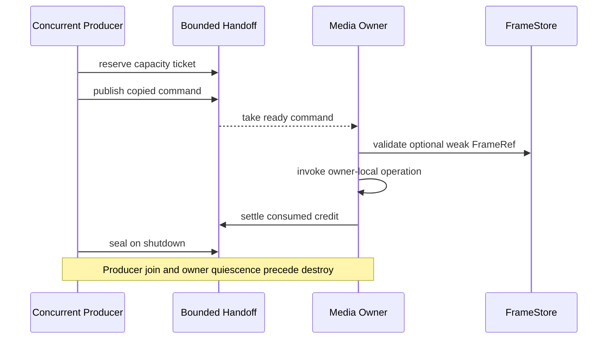

# TurboMedia::StreamGraph — typed graph compilation M0

**Development slices** [#163](https://github.com/qigao/turbomedia/issues/163), [#164](https://github.com/qigao/turbomedia/issues/164), and [#165](https://github.com/qigao/turbomedia/issues/165), under [StreamGraph v2 #162](https://github.com/qigao/turbomedia/issues/162). Typed graph preflight, a same-process CPU FrameStore, bounded Fanout and a narrowly scoped synthetic owner-driven Executor now exist on **stacked Draft branches**. This is **not** a fully general, released or production-qualified StreamGraph runtime.

The platform-neutral C11 header `turbo_streamgraph.h` models Source/Processor/Sink, six typed Port kinds and explicit edges. `tm_sg_compile()` deep-copies all IDs, Port descriptors and Edges, checks capacities, port direction, DAG cycle, schema, timebase, memory domain, media format, connectedness and fanout, and produces a read-only topology plan. Views remain borrowed until `tm_sg_program_destroy()`.

**Still missing:** provider selection and exact capabilities, codec/model loading, GPU synchronization, general DAG scheduling, full asynchronous FramePin ownership handoff, Observation serialization (#167), FFmpeg adapters (#166) and Android Capture. The M1/M2 constrained CPU components below do not satisfy these requirements. `format_id == 0` and memory `ANY` are unconstrained *proposals* requiring future explicit provider negotiation, not implicit conversion or a production capability claim.

`TurboMedia::StreamGraph` is a shared platform component, unlike desktop-only Pipeline. The small standalone CMake build supports fast conformance independent of a complete Salts/FFmpeg toolchain; its **test-only** installed `TurboMediaStreamGraph` CMake package does not prove the full TurboMedia package is usable.

```bash
cd streamgraph
cmake --preset native-ci
cmake --build --preset native-ci
ctest --preset native-ci
```

The existing Pipeline v1 is unchanged; v2 execution migration will be tracked separately and cannot silently fall back to the legacy scheduler.

## M1: CPU FrameStore (new constrained slice)

The companion `turbo_frame_store.h` declares an explicitly **owner-serialized,
same-process CPU-only** frame store with upfront bounded allocation and
generation-fenced `FrameRef` lookup. The initial `tm_fs_publish_cpu()` takes
a **copy** of the bytes into owned storage; do **not** advertise end-to-end
zero-copy or GPU surfaces. A `FrameRef` is a value identity, not a retention
claim. The Store issues one independently charged `tm_fs_pin_v1` per admitted
consumer; acquiring a `tm_fs_lease_v1` temporarily retains the slot while
`tm_fs_map_cpu()` exposes a borrowed read-only view.

A slot cannot be reused until it is explicitly retired and all pins/leases
settle. Duplicate pin/lease release is stale. The process-local Store
generation changes upon recreation; stale FrameRefs are rejected after Store
and slot reuse. `tm_fs_seal()` stops new publication/pin admission but
allows previously pinned work to settle; `destroy` returns BUSY for
outstanding credits. All operations must be serialized by the embedding
Media Owner; this does not create a second executor.

**Not provided:** GPU FrameLease, external zero-copy buffers, asynchronous
cross-thread/MPSC credit transfer, IPC broker, GPU fences, model inference,
cross-Graph scheduler or source adapters. A C11 local atomic is used only to
generate process-local Store incarnations. Frame identities are never persisted.
[FrameStore issue #164](https://github.com/qigao/turbomedia/issues/164)
remains open until full domain qualification.

## M2 bounded FrameStore fan-out (Draft implementation #165)

The new `turbo_streamgraph_fanout.h` is a **single-owner-lane** bounded branch admission contract above FrameStore. Branch storage is preallocated with explicitly finite capacity. Every admitted consumer gets a separate Store pin; copying a FrameRef/ticket does not copy its lifetime right. No frame pixel bytes are copied by fan-out.

- **ordered.lossless**: full queues reject the entire new frame *before* any preview eviction; no implicit drop or retry.
- **latest**: may evict only oldest unclaimed READY entries, never TAKEN/leased frames.
- **sample**: admits deterministic source-frame IDs 1, 1+n, 1+2n; skipped inputs do not consume credits.
- **owner APIs**: submit, take, acquire temporary FrameLease, settle, seal, discard-ready and destroy. Destroy refuses unreturned TAKEN pins; FrameStore lives longer than Fanout Owner.

This is **not** yet the full execution scheduler: no Source/Processor factory invocation, codec flush/EOF, multi-thread MPSC admission, timers, GPU Fence, cross-process Shared Memory, or FFmpeg migration. All calls are serialized by the embedding Media Owner; no hidden executor. Tests prove three-branch ordering/backpressure, pin-credit rollback, stale ticket rejection and safe drain. [#165](https://github.com/qigao/turbomedia/issues/165) remains open.

## M2 executable synthetic graph (Draft; owner-driven)

`turbo_streamgraph_executor.h` connects a compiled `tm_sg_program` to actual
Source/Processor/Sink callbacks and the CPU FrameStore + bounded Fanout. The
explicitly supported topology in the latest Draft is one Source, **1–8 ordered read-only Processors**, and 1–8 Sink nodes connected through typed CPU VideoFrame ports with resolved, nonzero format and timebase. An unrecognized DAG, GPU/ANY memory domain, missing
binding, or unsupported port is rejected rather than run partially.

The embedding caller owns **every** call and callback, including Source polls,
Sink visits, stop and destroy. There are no threads, pollers, implicit retries,
codec contexts or FFmpeg dependency. A Source copies at most one frame into a
bounded scratch buffer, then FrameStore owns a single CPU copy; Processor and
Sinks borrow short FrameLease views. For backpressure, the executor retains
at most one uncommitted FrameRef or producer-filled scratch frame and does **not**
poll Source again. This preserves an admitted recording frame when a branch or
FrameStore has no space. The Sink policy is implemented by the existing
`ordered.lossless`, `sample`, or `latest` Fanout Owner.

EOS seals Fanout admission but leaves queued Sink work deliverable. A requested
stop discards only an uncommitted frame; READY items require explicit
`discard_ready` or delivery, and destroy returns BUSY while credits remain.
Consumer callback failures are terminal for this slice; no action replay or
automatic retry is introduced.

`streamgraph_executor` CTest exercises synthetic Source/Processor/two Sink
execution, ordered recording vs latest preview, full lossless and FrameStore
backpressure, one pending frame with exactly-once Source progression, EOS,
cancellation and failed Sink cleanup. It is **not** a generic graph executor,
does not implement async callback completion, true cross-owner handoff, GPU
fences, FFmpeg Flush/Drain or plugin generation leases. Those are separate
qualification gates under [#165](https://github.com/qigao/turbomedia/issues/165)
and [#166](https://github.com/qigao/turbomedia/issues/166).

## M3 linear multi-Processor slice (Draft PR #174)

The synthetic owner-driven Executor now supports `Source -> Processor[1..8] -> Sink[1..8]` as a **single-owner CPU read-only visitor chain**. The Compiler's topological node order determines the callback sequence; the same FrameLease is borrowed by each Processor only during its callback. It does not mutate the pixel buffer, allocate an extra frame copy, create a scheduler thread or accept arbitrary DAGs.

Preflight rejects intermediate fan-out, skipped or ambiguous processors, non-matching Port kinds/formats/timebases, missing or duplicate Provider bindings and a chain longer than the finite Processor limit. The final Processor alone fans out through existing ordered-lossless, sample or latest branch policies. An error in any Processor stops further execution and invokes the existing safe stop/retire path.

The `streamgraph_multi_processor` CTest verifies two exact-order Processors and two Sinks, lossless backpressure without duplicate callback, rejection of intermediate-Processor branches and a failing second Processor. [PR #174](https://github.com/qigao/turbomedia/pull/174) qualifies this **narrow slice only**. A general Source/Processor/Sink execution DAG, per-node mutable outputs, cross-owner bounded asynchronous delivery, true TSan concurrency, EOS/flush across codecs and FFmpeg lowering remain separately outstanding under #165/#166.

## M4 concurrent Owner command inbox (Draft stacked slice)

The separate `turbo_streamgraph_handoff.h` provides a bounded **multiple-producer / single-consuming Media Owner** control inbox. Producers may execute `reserve`, `publish`, `abort`, and `snapshot` concurrently; the Media Owner alone calls `take` and `settle`. All slots and command storage are allocated upfront. Under a short atomic lock the inbox transitions RESERVED -> READY -> TAKEN -> FREE. Tokens contain an inbox incarnation and a slot generation, so copying an old token cannot reproduce a capacity credit.

Supported command values are `PUMP_SOURCE`, `PUMP_SINK`, `STOP` and `FRAME_NOTICE`. Each is a small, pointer-free envelope. **FRAME_NOTICE holds a weak FrameRef only**, not a FramePin or a pixel lease; the Media Owner must validate the target Store generation and reserve an actual Pin before any separate async request commits. The inbox never invokes `tm_fs_*` or `tm_ex_*` under its lock and does not add a worker/poller or hidden retry. The host must progress/wake the Media Owner, execute the command and settle the row.



`seal` blocks new reservations/publications but requires already-reserved tickets to be aborted. READY commands may still drain and TAKEN credits must settle before `destroy` succeeds. **A drained snapshot does not establish concurrency quiescence:** callers must stop/join all producers including post-publish wake tails and ensure no owner access before destruction.

`streamgraph_handoff` CTest uses four actual producer threads racing with a single owner reader (600 command deliveries) plus deterministic seal-vs-reserved and stale-incarnation tests. Native CI qualifies MSVC, Clang and GCC; Linux TSan is a distinct instrumented gate. This does **not yet** integrate a complete Graph Executor scheduler, pin-retaining analysis requests, GPU FrameStore, FFmpeg, native CNet wake or asynchronous Provider callbacks. [#165](https://github.com/qigao/turbomedia/issues/165) remains OPEN.

## M5 Owner Dispatch integration (Draft stacked slice)

The new `turbo_streamgraph_owner_dispatch.h` binds a **borrowed** MPSC Handoff Inbox, StreamGraph Executor and FrameStore to one caller-driven Media Owner. Producers publish only immutable commands; on `tm_od_step()`, the Owner takes at most one command, calls the existing `tm_ex_pump_source`, `tm_ex_pump_sink` or `tm_ex_stop` and settles the reserved Inbox row. The `tm_od_receipt_v1` reports the original correlation plus a typed `COMPLETED`, `BACKPRESSURE`, `EOS`, `REJECTED` or `FAILED` outcome.

**No automatic retry:** `BACKPRESSURE` settles the original command; a host may explicitly submit a new command after Sink or FrameStore progress. Source's own bounded scratch/FrameRef remains pending within the Executor and cannot be polled again until its backpressure is cleared. A STOP command seals future Inbox admission but already queued Sink work can be delivered or explicitly discarded before Executor teardown.

A `FRAME_NOTICE` is weak while queued. The owner attempts `tm_fs_reserve_pin` and `tm_fs_acquire_pinned`, maps a read-only CPU view during one callback, then releases Lease and Pin before returning its result. A frame reclaimed before owner take yields `STALE_FRAME`, never another slot's bytes. A callback may request retirement while leased; Store returns BUSY and automatically retires once its last Lease/Pin settles. No raw pixel pointer may leave the callback.

The `streamgraph_owner_dispatch` test exercises Source/Processor/Sink backpressure, explicit retry, EOS, STOP, stale vs live frame notice, callback reentrancy rejection, and multiple producer threads submitting real commands while one Media Owner services the Executor. [TSan workflow](../.github/workflows/streamgraph-core.yml) instruments both Handoff and this integrated path. The Dispatcher does not own its borrowed Executor/Store/Inbox. This still does **not** implement remote FrameRef, a long-lived pin transfer to TurboInteract, wake/poller integration with CNet, arbitrary media DAG execution, codec flush or FFmpeg lowering; #165 and #166 remain Open.

## M6 asynchronous Provider completion and cancellation barrier (Draft)

The new `turbo_streamgraph_provider_completion.h` is a bounded, versioned C11 registry for asynchronous Provider callbacks. The Media Owner calls `tm_pc_begin()` and reserves one in-flight credit **before** starting a Provider. A Provider callback thread calls `tm_pc_complete()` with that ticket. Only the Media Owner calls `tm_pc_take()` and `tm_pc_settle()`. No callback executes Graph operations or releases a Provider DSO from inside the portal's short atomic lock.

Concurrent cancellation is explicit: `request_cancel` fences the operation but does not pretend the callback has ended. If cancellation wins first and the Provider subsequently completes, the one terminal result remains `CANCELLED` and records `completion_observed=1`. If completion wins, cancellation returns ALREADY and the completed result remains authoritative. A Provider may call `cancel_quiesced` only **after** it has proved that no callback for that request can subsequently occur; doing so earlier violates the lifecycle contract. A synchronous Provider start failure uses `fail_start` only if no callback can arrive. Either terminal condition retains credit until the Media Owner settles it.

`seal` prevents new begin/admission but accepts an already-admitted callback's terminal completion, allowing safe Drain. `destroy` refuses outstanding in-flight, cancel-pending, READY or TAKEN rows; **all** producer threads/callbacks and borrowed Provider/DSO generations must be quiescent before destruction, independent of snapshot status.

Deterministic qualification checks version/identity/ABA, cancel-before-complete, complete-before-cancel, duplicate result rejection, shutdown settlement and capacity. Concurrent tests execute 160 cancellation/completion races and 320 genuine callbacks over four threads, now included in the Linux TSan, Windows/Linux/macOS and ASan/UBSan native gates. Installed C11/C++17 SDK consumers cover the new public symbols. This is a **Provider completion registry**, not yet a concrete FFmpeg/RTC Provider adapter, a CNet wake mechanism, async GPU frame retention, DSO lease manager or arbitrary DAG executor. #165 remains OPEN and the next integration must route terminal results into the Media Owner's event loop.
