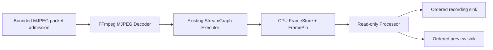

# StreamGraph desktop FFmpeg MJPEG decode Source — M11

**Development slice for [TurboMedia #166](https://github.com/qigao/turbomedia/issues/166)** stacked after [#182](https://github.com/qigao/turbomedia/pull/182). This is an **actual libavcodec MJPEG decoder**, not a synthetic frame generator. It is not a complete FFmpeg Pipeline replacement or production-qualified asynchronous Decode Provider.

## Scope and ownership

`turbo_streamgraph_ffmpeg.h` is an optional C11 interface with no FFmpeg public structs/types. The actual FFmpeg `AVCodecContext/AVPacket/AVFrame` remain private to the desktop provider library. All adapter calls are **owner-serialized**. The provider does not spawn an executor, poller, or worker pool, and is built only with `TM_STREAMGRAPH_ENABLE_FFMPEG_PROVIDER=ON`.

The first explicitly negotiated input/output profile is MJPEG compressed packet → decoded 8-bit **luma plane** at a fixed width and height. The adapter decodes through libavcodec, checks frame dimensions and pixel format, then copies one decoded luma plane into the existing `tm_ex_source_next_fn` owner scratch. The StreamGraph Executor copies that buffer **once** into the existing CPU FrameStore. There is no assertion of zero-copy, arbitrary pixel-format conversion, or GPU import.



- `tm_ff_submit_mjpeg` reserves **one finite pending packet** (byte bound and backpressure). Full/oversized input returns FULL without consuming or replacing the previous packet.
- The embedding Media Owner must call `tm_ff_ready` before pumping: an empty, not-yet-finalized Source must **not** be mistaken for EOS. The current general `tm_ex_source_next_fn` has no distinct WOULD_BLOCK result, so the caller owns that admission check; no hidden wake or poll loop.
- Backpressure after decoding remains in the canonical Executor's pending FrameRef/scratch and does not decode twice when the recording branch is full. The adapter must remain alive through any borrowed callback; it is destroyed after the Executor has stopped and drained its pins/leases.
- `tm_ff_finish` explicitly flushes the FFmpeg decoder; EOS seals the existing Fanout. `tm_ff_cancel` rejects new packets and abandons staged compressed input, but does not free already pinned FrameStore bytes; the Executor must stop/drain independently.
- The Graph profile is restricted to the existing one Source, 1–8 read-only Processors, 1–8 Sinks. FFmpeg decoding produces **one native luma profile**, not an arbitrary writable transformation DAG.

## Executable qualification

The `streamgraph_ffmpeg_decode` test creates a real FFmpeg MJPEG encoder in the **test**, generates three compressed packets without fixture downloads, then feeds the actual FFmpeg **decoder** Source into a typed StreamGraph Source→Processor→record+preview chain. It asserts decode value/FrameRef progression, full ordered-lossless backpressure without duplicate decode, the exactly-once pending-frame handoff, terminal EOS/flush and cancellation/oversize rejection. Separate Linux native and ASan/UBSan workflows install `libavcodec-dev` and `libavutil-dev` as **desktop-only test dependencies**.

To build locally where pkg-config and libavcodec headers are installed:

```sh
cmake -S streamgraph -B streamgraph/build/ffmpeg -G Ninja \
  -DTM_STREAMGRAPH_ENABLE_FFMPEG_PROVIDER=ON -DBUILD_TESTING=ON
cmake --build streamgraph/build/ffmpeg --target streamgraph_ffmpeg_decode_test
ctest --test-dir streamgraph/build/ffmpeg -R streamgraph_ffmpeg_decode --output-on-failure
```

## Independent installed adapter SDK

When `TM_STREAMGRAPH_ENABLE_FFMPEG_PROVIDER=ON` is selected in the isolated desktop build, CMake installs a **separate** `TurboMediaStreamGraphFFmpeg` package with the imported `TurboMedia::StreamGraphFFmpeg` target. Its config depends on the independently exported base `TurboMediaStreamGraph` package, so the original `TurboMedia::StreamGraph` ABI remains unchanged and consumers opt in explicitly.

After `cmake --install streamgraph/build/ffmpeg --prefix /path/to/sg-sdk`, a standalone application can use:

```cmake
find_package(TurboMediaStreamGraphFFmpeg CONFIG REQUIRED)
target_link_libraries(my_desktop_app PRIVATE TurboMedia::StreamGraphFFmpeg)
```

The FFmpeg runtime shared libraries remain desktop Provider dependencies; no `AVFrame` or `AVPacket` appears in installed public headers. The dedicated workflow builds a separate C11 and C++17 installed SDK consumer, executes it independently, and rejects a missing package export. This is **not** a production media-provider version/release claim.

## Still missing

This test is **Owner-driven synchronous decode**, not a real threaded FFmpeg I/O callback. It does not qualify live RTSP/HLS demux, encoded audio, scaler/intermediate data conversion, FFmpeg filter/encoder/mux output, a native Provider DSO containing libavcodec, or a CNet/NativeIO request-cancel-unload race. It does **not** retire `turbo.media.pipeline/v1` and must not introduce a fallback scheduler; migration requires the separate [#166](https://github.com/qigao/turbomedia/issues/166) exit gates. Also see [#165](https://github.com/qigao/turbomedia/issues/165) for final owner-wide drain/failure domain conformance.
