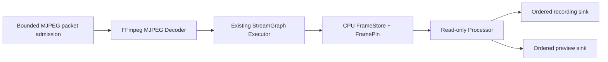
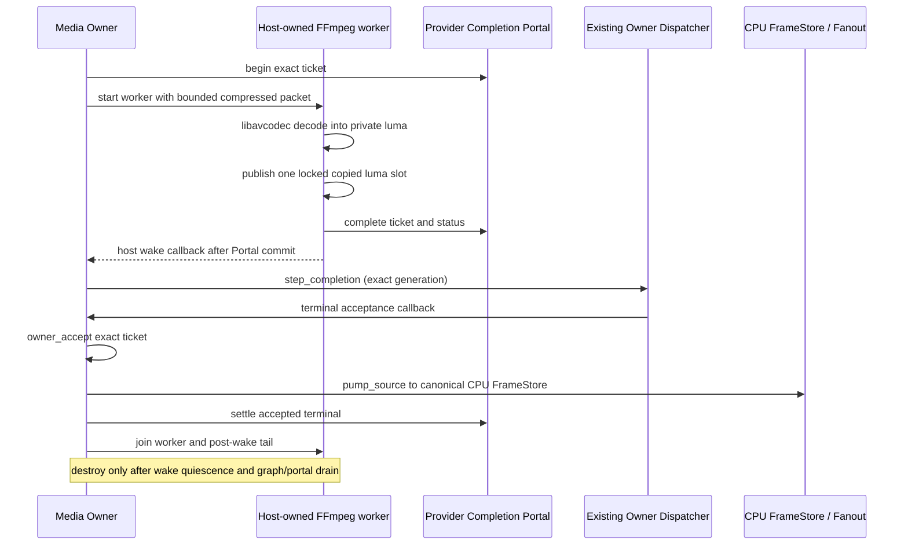

# StreamGraph desktop FFmpeg MJPEG decode Source — M11

**Development slice for [TurboMedia #166](https://github.com/qigao/turbomedia/issues/166)** stacked after [#182](https://github.com/qigao/turbomedia/pull/182). This is an **actual libavcodec MJPEG decoder**, not a synthetic frame generator. It is not a complete FFmpeg Pipeline replacement or production-qualified asynchronous Decode Provider.

## Scope and ownership

`turbo_streamgraph_ffmpeg.h` is an optional C11 interface with no FFmpeg public structs/types. The actual FFmpeg `AVCodecContext/AVPacket/AVFrame` remain private to the desktop provider library. All adapter calls are **owner-serialized**. The provider does not spawn an executor, poller, or worker pool, and is built only with `TM_STREAMGRAPH_ENABLE_FFMPEG_PROVIDER=ON`.

The first explicitly negotiated input/output profile is MJPEG compressed packet → decoded 8-bit **luma plane** at a fixed width and height. The adapter decodes through libavcodec, checks frame dimensions and pixel format, then copies one decoded luma plane into the existing `tm_ex_source_next_fn` owner scratch. The StreamGraph Executor copies that buffer **once** into the existing CPU FrameStore. There is no assertion of zero-copy, arbitrary pixel-format conversion, or GPU import.



- `tm_ff_submit_mjpeg` reserves **one finite pending packet** (byte bound and backpressure). Full/oversized input returns FULL without consuming or replacing the previous packet.
- The embedding Media Owner must call `tm_ff_ready` before pumping: an empty, not-yet-finalized Source must **not** be mistaken for EOS. The current general `tm_ex_source_next_fn` has no distinct WOULD_BLOCK result, so the caller owns that admission check; no hidden wake or poll loop.
- Backpressure after decoding remains in the canonical Executor's pending FrameRef/scratch and does not decode twice when the recording branch is full. The adapter must remain alive through any borrowed callback; it is destroyed after the Executor has stopped and drained its pins/leases.
- `tm_ff_finish` explicitly flushes the FFmpeg decoder; EOS seals the existing Fanout. `tm_ff_cancel` rejects new packets and abandons staged compressed input, but does not free already pinned FrameStore bytes; the Executor must stop/drain independently.
- The Graph profile is restricted to the existing one Source, 1–8 read-only Processors, 1–8 Sinks. FFmpeg decoding produces **one native luma profile**, not an arbitrary writable transformation DAG.

## Executable qualification

The `streamgraph_ffmpeg_decode` test creates a real FFmpeg MJPEG encoder in the **test**, generates three compressed packets without fixture downloads, then feeds the actual FFmpeg **decoder** Source into a typed StreamGraph Source→Processor→record+preview chain. It asserts decode value/FrameRef progression, full ordered-lossless backpressure without duplicate decode, the exactly-once pending-frame handoff, terminal EOS/flush and cancellation/oversize rejection. Separate Linux native and ASan/UBSan workflows install `libavcodec-dev` and `libavutil-dev` as **desktop-only test dependencies**.

To build locally where pkg-config and libavcodec headers are installed:

```sh
cmake -S streamgraph -B streamgraph/build/ffmpeg -G Ninja \
  -DTM_STREAMGRAPH_ENABLE_FFMPEG_PROVIDER=ON -DBUILD_TESTING=ON
cmake --build streamgraph/build/ffmpeg --target streamgraph_ffmpeg_decode_test
ctest --test-dir streamgraph/build/ffmpeg -R streamgraph_ffmpeg_decode --output-on-failure
```

## Independent installed adapter SDK

When `TM_STREAMGRAPH_ENABLE_FFMPEG_PROVIDER=ON` is selected in the isolated desktop build, CMake installs a **separate** `TurboMediaStreamGraphFFmpeg` package with the imported `TurboMedia::StreamGraphFFmpeg` target. Its config depends on the independently exported base `TurboMediaStreamGraph` package, so the original `TurboMedia::StreamGraph` ABI remains unchanged and consumers opt in explicitly.

After `cmake --install streamgraph/build/ffmpeg --prefix /path/to/sg-sdk`, a standalone application can use:

```cmake
find_package(TurboMediaStreamGraphFFmpeg CONFIG REQUIRED)
target_link_libraries(my_desktop_app PRIVATE TurboMedia::StreamGraphFFmpeg)
```

The FFmpeg runtime shared libraries remain desktop Provider dependencies; no `AVFrame` or `AVPacket` appears in installed public headers. The dedicated workflow builds a separate C11 and C++17 installed SDK consumer, executes it independently, and rejects a missing package export. This is **not** a production media-provider version/release claim.

## Still missing

This test is **Owner-driven synchronous decode**, not a real threaded FFmpeg I/O callback. It does not qualify live RTSP/HLS demux, encoded audio, scaler/intermediate data conversion, FFmpeg filter/encoder/mux output, a native Provider DSO containing libavcodec, or a CNet/NativeIO request-cancel-unload race. It does **not** retire `turbo.media.pipeline/v1` and must not introduce a fallback scheduler; migration requires the separate [#166](https://github.com/qigao/turbomedia/issues/166) exit gates. Also see [#165](https://github.com/qigao/turbomedia/issues/165) for final owner-wide drain/failure domain conformance.

## M12 — bounded asynchronous FFmpeg decoded-frame handoff (Draft)

The separate `turbo_streamgraph_ffmpeg_async.h` is a **one-packet / one-frame** production-facing C11 admission contract for a Host-owned Provider execution thread, built **only** with the optional desktop FFmpeg adapter. Neither StreamGraph Core nor the adapter spawns a worker or an additional scheduler. The caller reserves a generation-fenced `tm_pc_ticket_v1` with the existing `tm_pc_portal` **before** admitting its worker. Only that worker invokes the private `libavcodec` state through `tm_ffa_run_mjpeg`.



The Host supplies the `tm_ffa_wake_fn` and retains its context until **after worker Join**. In a normal CNet-owned Host this is a thin callback over the previously qualified installed `cnet_client_wake`; this standalone addon intentionally has no Salts dependency and its Linux conformance uses a bounded test wake gate, **not a live CNet client**. A failed wake cannot withdraw an already-completed Portal ticket or trigger a retry: the Host must explicitly resume its Owner in that case. A wake is not an acknowledgment or permission to unload a Provider.

`tm_ffa_owner_accept` checks the **exact Portal incarnation, slot and generation** before the Executor may call `tm_ffa_owner_next_luma`. It transfers a single CPU luma COPY into the Executor scratch. The existing Executor then owns its pending FrameRef, including any lossless fanout backpressure. When the decoder has no accepted frame, the Owner must **not** call `pump_source`: empty Source is not EOS. The async adapter does **not yet** implement a delayed-codec flush or EOF sentinel; that remains a separate admission/Codec state contract.

**Cancel vs completion:**
- Cancel-before-worker-admission is settled only after the Host proves that no worker was ever started and calls `tm_pc_cancel_quiesced` on the already-cancelled Portal ticket.
- In-flight cancel must first win `tm_pc_request_cancel`; then the Owner may call `tm_ffa_owner_cancel` to prevent or discard pixel delivery. The callback must still report completion, exit its code and finish the post-Portal wake tail. A worker can hold a busy codec or a wake callback after its Portal already says COMPLETED.
- Completion-before-cancel does **not** fabricate a CANCELLED terminal. The Owner may explicitly discard an already decoded frame, preserving the actual completed terminal result.
- A downstream terminal delivery rejection leaves the Portal TAKEN credit and actual decoded slot alive; the Host must explicitly reconcile, discard if necessary and settle once, not re-emit or re-decode.
- `tm_ffa_destroy` rejects a live worker tail and an undelivered decoded buffer. It does **not** release outer `Salts::ComponentPlugin` Generation Scope or claim any DSO quiescence.

Executable tests use the **real FFmpeg MJPEG encoder and decoder** with actual pthread worker-vs-Media Owner concurrency, wrong-generation ticket rejection, multi-frame ordered lossless backpressure, wake failure without retry, completion-first cancellation, cancellation before worker admission, and downstream delivery refusal. Linux native, ASan/UBSan, and TSan instrument both addon and StreamGraph; **system FFmpeg shared libraries are not fully TSan-instrumented**. Independently installed C11/C++17 consumer tests exercise the exported optional addon ABI.

**Not yet qualified:** an FFmpeg Codec running inside a real Salts ComponentPlugin DLL, native FFmpeg demux/network I/O cancellation and socket terminal completion, native CNet wake inside this same FFmpeg worker test, GPU surface fences, delayed frames/multi-packet decode, writable graph transforms, audio, and full `Pipeline v1` retirement. These stay open under [#165](https://github.com/qigao/turbomedia/issues/165) and [#166](https://github.com/qigao/turbomedia/issues/166).
