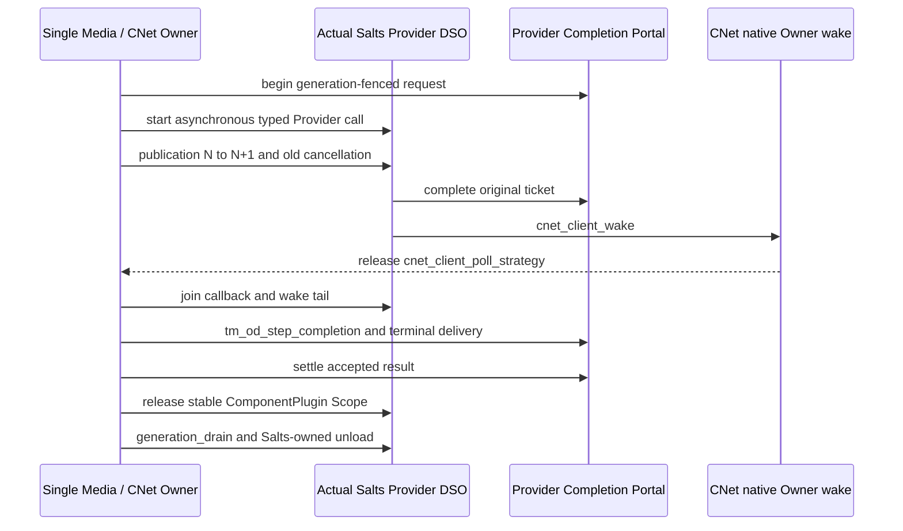

# Installed Salts CNet wake → Provider Completion → StreamGraph Owner

This test is **not** a fake network wake. It links `Salts::CNet` from the exact installed
`Salts.Native 2.3.0-rc.14` SDK, using `cnet_client_init`,
`cnet_client_poll_strategy` and `cnet_client_wake`, together with
`Salts::ComponentPlugin` and the independently installed `TurboMedia::StreamGraph`.

## Execution and ownership

- `cnet_client_wake` is the **only CNet operation permitted from the Provider callback thread**; `poll_strategy` / all other CNet operations remain on the owner lane. This is the canonical CNet-owned progress path, not external-progress CNet or a NativeIO-sharded callback owner.
- Completion data is **published before wake**. Wake coalescing is allowed and does not constitute a completion receipt. The Portal remains the authoritative finite terminal queue.
- The Provider Scope and CNet client storage remain live through callback exit **and the post-completion wake tail**. The Host joins callback threads before `cnet_client_stop` and `cnet_client_destroy`, before releasing the original Generation Scope, and before the Salts Plugin unload. Never treat a drained Portal as proof that a foreign callback can no longer call wake.
- The owner waits with the installed `cnet_client_poll_strategy` once for each released Provider request, then executes the existing `tm_od_step_completion` acceptance path and separate explicit Portal settlement. No automatic retry on refusal or cancel.
- Real OS backend selection is explicit: Windows IOCP, macOS Kqueue, Linux epoll. Unsupported backend/init fails, with **no fallback** to condition variables, ad hoc polling or a different transport. Wake is not an extra scheduler or I/O thread.
- A truly external NativeIO owner must use its *own* host-provided wake/progress contract, not `cnet_client_wake` on an external-progress client. This fixture covers only ordinary CNet Client progress.

**Qualification:** exact SDK package source SHA/manifest/checksum, two real Salts ComponentPlugin generation DSOs, old callback running while N+1 publishes, cancel plus blocked early drain/unload, actual CNet wake + Owner terminal delivery, callback join and late-wake quiescence, exact NativeIO/backend lifetime, C11 installed SDK build on Windows/Linux/macOS.

**Not yet covered:** nonempty live socket traffic / CNet connection observation, same-repository TSan instrumentation of the prebuilt released Salts binary, FFmpeg/RTC callbacks, GPU FrameLease or arbitrary DAG scheduling. Parent [TurboMedia #165](https://github.com/qigao/turbomedia/issues/165), [#180](https://github.com/qigao/turbomedia/issues/180).
