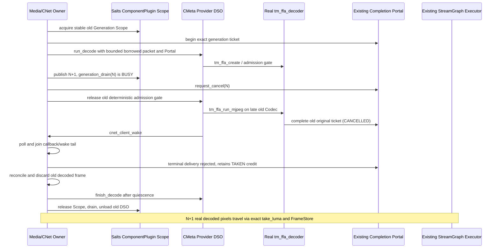

# M14 — Actual `tm_ffa_decoder` under Salts ComponentPlugin DSO

**Purpose:** Close the architectural mismatch identified in M13: the prior real Codec-in-DSO test implemented its *own* one-shot libavcodec decoder. This gate instead invokes the existing **M12 production-facing `tm_ffa_decoder`** from inside a real, dynamically loaded Salts ComponentPlugin DSO. Tracks [#165](https://github.com/qigao/turbomedia/issues/165), [#166](https://github.com/qigao/turbomedia/issues/166), [#180](https://github.com/qigao/turbomedia/issues/180).

## Single implementation, three canonical owners

- **Decoder:** `TurboMedia::StreamGraphFFmpeg` installed desktop add-on supplies `tm_ffa_create`, `tm_ffa_run_mjpeg`, `tm_ffa_owner_accept`, `tm_ffa_owner_next_luma`, `tm_ffa_owner_cancel`, `tm_ffa_destroy`. DSO does **not** compile its own libavcodec decode function. The FFmpeg library and AVFrame/AVPacket stay private behind the add-on C11 ABI.
- **Plugin lifetime:** Published `Salts::ComponentPlugin` Generation Scope remains the sole lease authorizing the CMeta Provider DSO's code and borrowed service. Only `cmeta_plugin_registry` loads/unloads the native DLL/DSO. No second Plugin Registry or host test `dlopen`.
- **Owner / result:** Host reserves one exact `tm_pc_ticket_v1` before invoking the CMeta method. The **real `tm_ffa_run_mjpeg`** publishes the luma slot, invokes `tm_pc_complete` on the same Portal and calls a DSO-local callback that invokes actual `cnet_client_wake` *after* completion. The Media Owner owns `cnet_client_poll_strategy`, `tm_od_step_completion` and typed CMeta `take_luma` to feed the existing StreamGraph Executor → FrameStore → Processor → Sink. The wrapper **never** publishes a second Portal completion or sends another wake.

## Deterministic verified invariants

1. Two distinct native Salts Provider DSOs are built from the installed SDK. In Linux only, both depend on the independently installed **`TurboMedia::StreamGraphFFmpeg`** library. The Host's concrete test-only CMeta interface carries borrowed `tm_pc_portal*`, exact ticket identity, compressed bytes and CNet Client pointer, not an `AVFrame` or serialized runtime state.
2. **Only one Portal completion and one CNet wake per admitted Provider operation**. The earlier extra completion/wake in the wrapper has been removed for Linux M14; the original Windows/macOS (FFmpeg-free) generation test is unchanged.
3. Exact Scope lifetime: old N's DSO call is active during generation publication and cancellation. `finish_decode` returns BUSY while that call remains active, including the *pre-codec* admission gate. Its `tm_ffa_decoder` cannot be freed while the worker retains code/state; `generation_drain(N)` and `Plugin unload(N)` also refuse with BUSY.
4. The old N is cancelled **before** the production decoder calls `tm_pc_complete`. Its late real decode still returns under its authorized Scope, but the Portal reports CANCELLED. Rejected downstream delivery must not consume/publish its CPU frame, and requires explicit Host reconciliation/credit settlement.
5. N+1's real luma output can be retrieved **only after Media Owner accepts the terminal**. A stale Ticket generation cannot obtain the ready decoded slot, and the real exact Ticket can transfer exactly once into the Graph's CPU FrameStore / Processor / Sink. Pixel values and sizes are checked.
6. All async worker threads and DSO-local wake callbacks are joined before deleting the `tm_ffa_decoder`, releasing its enclosing ComponentPlugin Scope, draining/unloading the DSO or stopping the borrowed CNet client.
7. Linux CI acquires released `Salts.Native 2.3.0-rc.14` and separately installs both StreamGraph Core and opt-in StreamGraphFFmpeg desktop SDK. Package/checksum/source/ABI are verified; no Salts checkout or source-tree header masquerading. Windows/macOS continue the established true DSO/CNet gate without FFmpeg.

## Limits — keep parent issues open

The *Provider CMeta envelope* is an executable integration fixture; a stable, user-facing typed Provider SDK/factory with multiple requests and independent Instances is **not** yet shipped. One DSO has one test-owned `tm_ffa_decoder` and a single active request. The old-generation deterministic gate holds the DSO method **before** its actual Codec call to force cancel-first; this does **not** prove cancellation racing inside the FFmpeg `avcodec_send_packet` call itself. The test drives no live RTSP/RTC sockets, NativeIO cancel/observe terminal, delayed FFmpeg decode flush, GPU Fence, multi-format audio/video or Pipeline v1 retirement. Prebuilt released Salts libraries and system FFmpeg remain **un-instrumented under TSan** even though StreamGraph's own tests are TSan-enabled. No full hot-swap / FFmpeg production completion claim.
