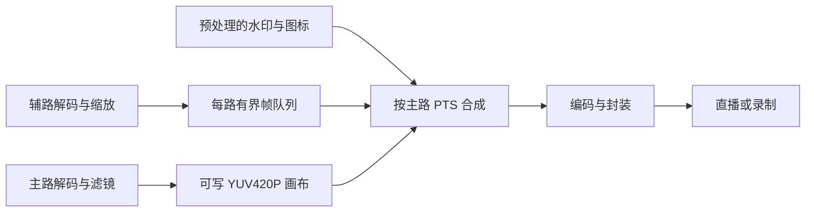

# Pipeline 视频叠加与多路合成设计

## 目标与选择

在现有逐帧编辑入口上实现三种输出场景。直播水印将一张带 Alpha 的图片放在固定位置。Logo、状态图标和应用预渲染的字幕使用相同的图片层。画中画与拼屏将其他视频源缩放到指定区域，合成一路视频供推流或录制。主路提供画布、输出节奏和音轨，辅路贡献视频画面。

当前 Pipeline 每张图接收一个输入，视频转码分支在滤镜输出后提供可写的 YUV420P 帧。该回调持有主画布直到返回，时间戳使用编码器时钟。合成器复用这个位置，完成合成后仍由现有 Pipeline 编码、封装和分发。 [逐帧编辑 API](../include/turbo_pipeline.h) · [v1 图契约](../README.md#v1-图契约)

| 方案 | 适用范围与取舍 |
| --- | --- |
| 扩展 FFmpeg 多输入图 | 适合按统一时间线离线处理文件。当前 v1 过滤链为单输入单输出，扩展需要新增图校验、输入调度和 EOF 语义。 |
| 在逐帧回调中运行 CPU 合成器 | 同一条主路可接收应用图层和独立解码的实时辅路。合成器集中处理颜色、层顺序和对齐，Pipeline 复用原有编解码及输出。选用此方案。 |
| 用 StreamGraph 分发已解码帧 | 适合下游预览和分析。现有执行器向处理器提供只读帧视图，要在此处合成需要增加可写输出与多源调度契约。 [StreamGraph 执行器](../../../streamgraph/include/turbo_streamgraph_executor.h) |

## 接口与模块归属

合成器实现归 `streaming/pipeline/`，随 `TurboMedia::Pipeline` 导出。像素内核只接收像素平面和矩形，适配层负责 FFmpeg 色彩、尺寸及时间戳转换。辅路采集、解码和传输由应用或独立的输入适配器推进。

| 操作 | 当前接口契约 |
| --- | --- |
| 创建合成器 | 接收画布、层列表、辅路配置和内存预算。校验并复制配置，编译矩形与层顺序。任一步失败释放已建资源，原有图可以继续使用。 |
| 准备图层 | 图片输入为 RGBA8 像素及有效行范围。创建期间复制并预处理成合成格式，接口返回后应用即可释放原始像素。 |
| 绑定 Pipeline | 在 `CREATED` 状态绑定到视频转码分支，复用逐帧回调槽位。Pipeline 借用合成器至销毁。绑定冲突返回状态错误，原绑定继续有效。 |
| 移动图层 | 控制端按创建顺序一次提交全部图层的坐标。下一次逐帧回调采样最近一次成功提交的坐标，整帧使用同一批位置。尺寸、顺序和透明度取自创建配置。 |
| 提交辅路帧 | 指定输入编号、统一时间戳和只读像素视图。在调用期间校验并复制到该路预分配槽。返回成功表示帧已对合成线程可见，返回队列满时原帧仍属于提交方。 |
| 合成与统计 | `run` 线程串行合成。应用可读取原子统计快照，包括成功提交、队列满、过期、缺帧和各路队列峰值。 |
| 停止与销毁 | 关闭入口，等待生产者和 Pipeline 退出，再释放图层像素及队列。 |

创建时定义图层及初始布局。各层按配置顺序自底向上绘制。每层描述源、画布像素矩形及整体透明度。显式主视频层与辅路可以各自指定格子的宽高。Pipeline 的 FFmpeg 滤镜先按主路显示宽高比缩放，将主画面居中放入画布左上角的一块等尺寸临时区域。合成器将这块区域复制到预分配的暂存平面，再填充背景并按当前布局绘制。这样能直接使用滤镜后的主路宽高比，并把主图层移动限定为坐标更新。黑色背景采用限幅 YUV 值 16、128、128。图片适配和辅路缩放复用 FFmpeg 转换能力，缓存转换上下文。 [公开接口](../include/turbo_pipeline_compositor.h)

例如，1920×1080 画布可先画满主路，再将辅路放到右下角的 `(1264, 696, 640, 360)`，最后将 Logo 放到 `(24, 24, 160, 64)`。同一画布的四宫格可使用四个 960×540 矩形，将主路画面放入第一格。

运行时切换整组位置适用于移动画中画、Logo 或交换同尺寸格子。创建时按图层数预留两份坐标数组，计入合成器内存预算。控制线程先校验整组输入，再在互斥区复制到待应用数组。合成线程在帧起点交换数组，混合阶段独占当前坐标，锁内只做复制或交换，定位也复用原有图层像素和缩放上下文。此方案允许提交合并，避免拖动产生的中间位置排队。坐标无效时整组拒绝，关闭后停止接纳更新，已接纳的位置仍可用于排空帧。应用可继续仅使用创建时布局，公开配置结构和 YAML v1 契约保持兼容。

## 像素、透明度与颜色

合成工作格式选用 8 位 SDR BT.709 limited range 的 YUV420P。主路适配层在交给编辑器前完成实际色彩转换并配置编码器与输出的相应色彩元数据。辅路按同样的工作格式转换。图片入口约定 straight Alpha 的 sRGB RGBA8，在准备时转换色彩与传递函数。色彩信息缺失时，调用方可在配置中指定输入的色彩解释。遇到不支持的色彩空间或与声明不符的输入时，报告格式错误。

现有公开帧视图提供尺寸、跨度和时间戳。合成器绑定时把工作色彩要求交给 Pipeline 内部的 FFmpeg 适配层，公开帧结构与 YAML v1 继续沿用。仅写入色彩标签不能完成像素转换，因此验证同时检查已知色块的值和编码后的标签。 [帧视图](../include/turbo_pipeline.h) · [现有像素格式协商](../src/turbo_pipeline.c)

- 目标矩形对齐到 2×2 像素网格，创建时验证范围。层尺寸按需要等比缩放，在目标区域内居中。视频层空余区域填充黑色，图标层空余区域透明。覆盖全部画布的布局先确定底层背景，再叠加视频和图标。
- 图片缩放使用预乘 Alpha 的像素计算插值，准备阶段生成亮度样本、Alpha 和色度的预乘贡献。这样透明区域的原始颜色不会沿缩放边缘混入。
- 每个像素的有效 Alpha 是像素 Alpha 和图层不透明度的乘积，按 255 归一化并取整。亮度混合值采用 `(a × src + (255 − a) × dst + 127) / 255`。每个色度样本对应 2×2 块，用 `A = Σa`、`P = Σ(a × src)` 得到混合值 `(P + (1020 − A) × dst + 510) / 1020`。这些除法都取整数。四个 Alpha 全零时原样保留该块。这里混合的是 SDR 编码样本值。
- 逐行使用 `stride`、`row_bytes` 与 `rows`，支持正负行跨度。图片与辅路的外部输入描述需要给出每平面的存储起点、字节数和首行偏移。读写前验证首尾行和行宽落在有效区间，相关加法和乘法均检查溢出。主画布使用 Pipeline 已校验的回调视图。

## Direct3D 11 合成与分析

Windows 应用可显式选择 `TURBO_COMPOSITOR_D3D11`。Direct3D 11 提供系统级计算支持，同一后端可使用不同厂商的硬件。设备创建在能够使用 feature level 11.0 的硬件适配器中优先选择专用显存最大的设备。现有 CPU 构造方式仍适用于较轻的布局和其他平台。 [设备创建契约](https://learn.microsoft.com/en-us/windows/win32/api/d3d11/nf-d3d11-d3d11createdevice)

合成器持有设备、计算着色器、固定容量的上传和读回缓冲，以及 GPU 上的只读图片数据。每帧由 `run` 线程选取辅路，上传当前布局及所需像素，在 GPU 上按层序对三平面执行相同的整数混合，再同步读回到现有画布。现有 I420 接口使 FFmpeg 的滤镜和编码器无需迁移。逐帧传输和同步的成本随画布和输入大小变化。 [读回拷贝契约](https://learn.microsoft.com/en-us/windows/win32/api/d3d11/nf-d3d11-id3d11devicecontext-copyresource)

创建时可启用 256 桶亮度直方图。GPU 按线程组累计已合成的 Y 样本，再归并并读回结果。直方图和时间戳在整帧处理成功后一起发布，读者复制最新快照。应用预算包含上传、输出、读回、图片准备期的临时副本，以及可选的直方图缓冲区。显式选择 GPU 时，设备或资源创建失败由构造函数报告，运行期设备错误沿用逐帧编辑失败处理。应用可在重新创建合成器时选择 CPU 构造方式，配置和媒体格式沿用原有契约。

## 辅路同步与背压

主路决定每一张输出画布的时刻。应用为每路设置源 PTS 到同一个会话时间轴的映射，包括时间基和锚点。主路回调按编码器时间基换算到会话微秒，辅路适配器在提交前做同样的换算。文件可使用显式起始偏移。远端直播源可使用已有时钟映射或由应用提供的 RTP/RTCP 对时结果。锚点来自应用的同步依据，各路各自的首帧 PTS 只在应用明确要求对齐首帧时作为锚点。缺少主路有效时间戳时，只有固定图片层的布局可以直接绘制，包含辅路的布局报告时间戳错误。

Runtime/RTP 主路转码使用延展后的 64 位 RTP PTS。显式编码帧率先确定固定节奏，再从辅路选取对应帧。沿用输入节奏时，应用按输入时间基配置主路锚点。Runtime 发布前用合成画布填写输出轨道尺寸。

在主路时刻 `T`，每路按提交顺序消费时间戳小于或等于 `T` 的帧，选最新一张。未来帧保持排队。时间戳相同时后提交者胜出。每路接受单调时间戳，缺失、向后跳变或使用旧时间轴的帧在提交时拒绝。辅路短暂断流时复用最近帧直到配置的 `max_age_us`。超过该期限或从未收到帧时，按图层显式配置的缺帧策略绘制背景或报告错误。布局生命周期内采用同一时间轴，seek 或主时钟跳变后创建新的 Pipeline 和合成器来建立新时间轴。

实时推流和同步录制共用这条非阻塞取帧路径。要求可重复结果的离线文件拼接应使用同一个像素内核，由离线适配器在每个主路时刻按需拉取本地辅路，获得最近帧和首张未来帧或读到 EOF 后才合成。这样落在哪一张辅路帧由文件时间线决定。离线适配器单独管理读盘、协作停止和 EOF。

| 资源 | 所有者与上限 |
| --- | --- |
| 主画布 | Pipeline 持有。合成线程只能在回调期间写入有效像素。借用在回调返回时结束。 |
| 图片与主画面暂存 | 合成器在准备阶段分配。图像层像素在运行期间只读，暂存平面由合成线程独占。 |
| 辅路像素槽 | 每路一个生产线程和一个合成消费者。每个槽依次经历空闲、写入、就绪、渲染持有，最后回到空闲。满时返回队列满，生产者不覆盖已发布的帧。 |
| 辅路索引队列 | 复用 Salts `ring_spsc_t`。每路的就绪环由解码线程写、合成线程读，空闲环由合成线程写、解码线程读。环中只传固定宽度的槽索引。 |

生产者取得空闲槽后在队列外缩放、复制和写元数据，提交索引时才发布完整帧。转换失败时该槽停留在生产者本地供下次写入。消费者每次回调最多处理每路配置的槽数，取帧和混合过程中无网络等待。被渲染持有的帧在换用新帧或超过有效期后释放。两环都能容纳配置的槽数，并按 Salts 环的二次幂容量和连续读写要求校验初始化结果。

容量按实际行跨度累计三平面大小，再乘每路槽数，同时计入图片、缩放暂存及队列元数据预算。例如紧凑的 640×360 YUV420P 帧为 345,600 字节，三路辅路各三个槽共 3,110,400 字节，约 2.97 MiB。该计算只包含辅路像素，运行时以对齐后的真实分配量为准。FFmpeg 编解码器、滤镜及缩放上下文的内部内存属于各自的资源预算。

## 输入适配、关闭与错误

应用已有解码器时可以直接提交只读帧。URL 辅路可复用 Player 的解码回调及 `pts_ms`，在回调返回前完成复制。Player 复用输出缓冲区，且公开视图仅提供像素格式和时间戳，因此它适合已确认工作色彩的源。需要色彩校验或转换的输入通过能读取解码元数据的 FFmpeg 适配器进入。Runtime 媒体源提供压缩帧或 RTP 包，辅路由其专属解包和解码适配器提供像素。 [Player 公开帧](../../../media/codec/include/turbo_player.h) · [Player 缓冲区复用](../../../media/player/ffmpeg_player.c) · [Runtime 媒体源](../../../media/runtime/include/turbo_media_source.h)

主路停止后结束输出。正常文件 EOF 沿用 Pipeline 的滤镜与编码器排空，剩余主帧仍通过合成器。主动停止时先停止接纳，并等待布局更新、辅路提交等外部调用结束。Runtime/RTP 的 runner 停止接纳输入后返回。等待 `run` 和并发 stop 调用退出，并确认输入 publisher 静止后，由 Runtime 所有者销毁 Pipeline、退订输入。最后释放合成器。如果输出仍在排空，合成器与可用的辅路帧保持有效。

无效布局、超出预算或无法转换的格式在配置阶段报告。运行中回调收到非法画布或必需辅路超期时，以已有 `TURBO_PIPELINE_ECALLBACK` 结束运行，保留已输出的前缀。辅路提交错误按来源编号反馈给应用，队列满、时间戳倒退和格式变化分别计数。控制端可从统计快照定位丢帧和缺帧，合成热路径按现有日志策略记录必要的终态错误。

## 实现顺序与验收

1. **图片层**。先实现准备期的颜色和 Alpha 转换、带跨度的三平面混合和 Pipeline 绑定。用已知色块验证透明、半透明、完全覆盖与重叠顺序。验证负行跨度、边界矩形、大尺寸溢出、NV12 输入转换，逐字节核对原始输出像素，再解码一次实际编码输出检查色块和颜色标签。
2. **视频层**。加入辅路提交、容量预算、时间轴与 PiP 布局。用带时间标记的两路合成源测试未来帧保留、同 PTS、时钟偏移、断流过期、恢复、满队列与停止时回收。用同一输入验证画中画和拼屏几何。RTSP 或 WebRTC 输入链路验证辅路解码和会话时钟映射。
3. **输出和回归**。复用现有 Pipeline CTest、安装包测试与 ASan。在 FFmpeg URL 路径验证录制与推流收到相同合成内容，在 Runtime/RTP 路径验证解码后的输出。对辅路生产者与合成消费者运行线程检测，并记录容量峰值和每帧合成时间供选取部署参数。

应用先采用图片层，随后为各辅路绑定时间轴和容量配置。完整合成只创建一张编码画布。回滚时去掉合成器绑定并恢复原有视频转码配置，应用重新运行原图。媒体和持久化配置沿用现有格式。
